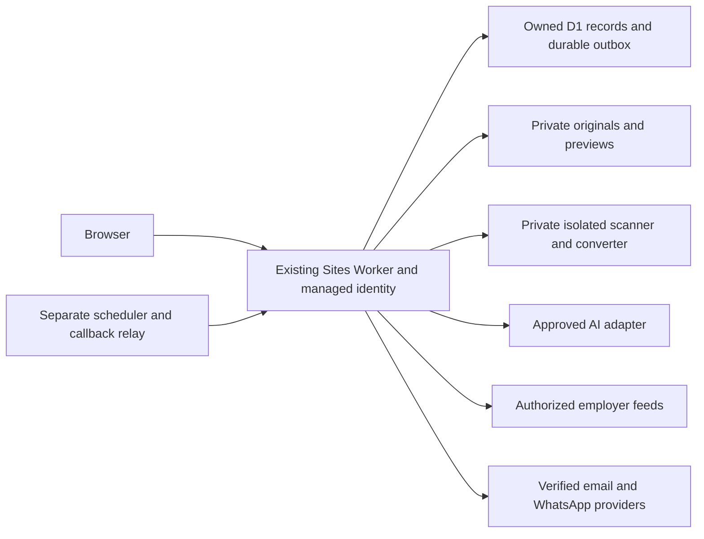

# DnyanGanga Career Hub

**Your AI-Powered Career Growth Platform

Domain setup on 13 October 2026: Hostinger DNS connects `https://dolphincreation.com` to the same owner-private platform; email records and existing data are preserved. [Actual domain results](docs/dolphincreation-domain-setup.md), [release pipeline](docs/hosting-and-domain-plan.md), and [test evidence](docs/pipeline-test-results.md). GitHub verification runs on pushes; production publishing is a separate native Sites action.**

This update extends the existing website, source repository, private Sites URL, managed sign-in, D1 database and R2 binding. It preserves the supplied green/orange logo, light design, original routes and existing records. The public workflows of Resodro, LoopCV and Simplify informed feature selection; their content, assets and outcome claims were not copied. Review and integration evidence: [connections guide](docs/integrations-update.md).

The current release is a **private review build**. Core account workflows work with real database records. External AI, live job feeds, document processing, email and WhatsApp have implemented server adapters but remain disabled until their required access, infrastructure and acceptance checks are complete. No provider key, job permission, real message, payment or production performance result is implied.

The current update coordinates **21 specialists and one central orchestrator**. It adds goals, learning tasks, a recruiter CRM, a manual interview calendar, privacy/data-use views, resume fact-review indicators, templates, differences and PDF/DOCX/text exports. Campaigns select independent resume versions and daily/weekly/manual frequencies. Screening answers expire and are explicitly selected for each package. Read the [current handover](docs/platform-handover.md), [workflows](docs/platform-workflows.md), [data changes](docs/platform-data.md), [research and cost assumptions](docs/platform-research-costs.md), and [current verification](docs/platform-test-results.md). Earlier `agentic-*` guides document the previous release.

## What works and what needs setup

| Area | Working in this update | Remaining setup or limit |
| --- | --- | --- |
| Accounts | Sole administrator email/password and authenticator; existing workspace mapped through proved ownership | Public registration and other application login methods are disabled. Initial private provisioning, hosted acceptance and independent perimeter cutover must be verified; automated recovery remains unavailable |
| Profile | Editable career facts, multiple locations, mandatory/flexible preferences, salary range/currency/basis | Nonessential fields optional; no inferred or auto-confirmed qualifications |
| Resumes | Manual editor/live preview, autosave/recovery, immutable versions, differences, restore/archive, explicit active selection/deletion, section visibility/order, three templates, PDF/DOCX/text export | Original PDF/DOCX ingestion requires a private scanner/converter; OCR is unconnected. PDF fonts support Latin scripts; DOCX/text preserve other scripts |
| Jobs | User-provided descriptions, source attribution, unknown fields, filter-first explained matching, saved jobs and candidate-updated applications | Official Greenhouse board adapter awaits authorized employer boards and separate display/digest/AI rights; other portals are unconnected |
| Career support | Private persisted sessions, structured self-review, separate reviewed resume/cover-letter drafts, interview questions/answers/checklists and saved history | External AI requires approved server configuration; self-review is clearly labelled and is not a model evaluation; voice remains unavailable |
| Career planning | Confirmed goals, source-linked learning tasks, owned recruiter contacts/interactions and manual time-zone-aware interview calendar | External email/calendar sync, networking discovery and employer messages remain unavailable |
| Alerts | Preferences, verified-destination workflow, per-channel consent, durable outbox, retries, deduplication and signed callbacks are implemented | No sending credentials or deployed external scheduler/relay; defaults are 08:00 Asia/Kolkata; bounded pilot scheduling is not large-audience capacity |
| Privacy | Ownership checks, private files, conversation/document deletion and owned export | Public sharing, whole-account deletion and admin access fail closed pending trusted identity capabilities |
| Commercial | Existing unconfigured pricing and disabled billing preserved | No new paid plans, checkout or payment credentials introduced |

Candidate counts come from their activity. `/demo` uses explicitly fictional records in session memory and has no live connections. Opening an application link does not mark it Applied or submit a resume.

## Architecture and pages

The existing React/TypeScript/Vinext application runs on a Sites-managed Cloudflare Worker. D1 stores relational records; server SQL enforces ownership. R2 keeps originals and previews private. Provider credentials belong only in server secret storage. AI providers implement a replaceable interface. A separate Worker supplies Cron and public signed callbacks/unsubscribe without turning that service token into a user identity. Document-conversion worker source is supplied; it requires deployment behind an authenticated private service binding on isolated Linux infrastructure before uploads can be enabled.



| Route | Purpose |
| --- | --- |
| `/`, `/features`, `/how-it-works`, `/faq` | Public product explanation and workflow |
| `/contact`, `/pricing`, `/privacy`, `/terms`, `/security` | Support, unconfigured plans, policies and status |
| `/demo` | Labelled fictional preview |
| `/dashboard` | Profile completion, current resume, matches, progress, interviews and delivery status |
| `/dashboard?view=agents` | AI Agent Command Center, knowledge vault, saved searches and application reviews |
| `/dashboard?view=goals`, `?view=vault`, `?view=searches`, `?view=review` | Career goals, direct vault/campaign/review views |
| `/dashboard?view=learning`, `?view=recruiters`, `?view=calendar`, `?view=privacy` | Learning, recruiter CRM, manual interview calendar and privacy controls |
| `/ai-career-agents`, `/resume-tools`, `/job-discovery`, `/interview-preparation`, `/career-coaching`, `/about`, `/login`, `/sign-up` | Original public feature/about pages and managed sign-in entry points |
| `/dashboard?view=profile` | My Profile |
| `/dashboard?view=resumes` | My Resumes, editor and upload status |
| `/dashboard?view=jobs`, `?view=saved` | Job Matches and Saved Jobs |
| `/dashboard?view=applications` | Application Tracker |
| `/dashboard?view=coach`, `?view=interview` | AI Career Assistant and Interview Practice |
| `/dashboard?view=notifications`, `?view=settings` | Alerts and Settings |
| `/dashboard?view=insights` | Preserved legacy URL; current research service remains unavailable |
| `/admin` | Admin setup status; protected APIs deny access without trusted role and fresh MFA |
| `/signin-with-chatgpt`, `/signout-with-chatgpt`, `/callback` | Reserved native identity routes |
| `/api/career/[...path]` | Owned account API plus separately authenticated scheduler/callback endpoints |

The reusable light design remains in `app/globals.css`; shared navigation/cards/forms and the supplied logo are reused. Focus styles, reduced-motion support and responsive layouts are retained.

## Handover and main files

- [Security checklist, remaining risks, release and maintenance](docs/update-handover.md)
- [Database, uploads, API contracts and backend tests](docs/backend-update.md)
- [AI privacy, evidence validation, quotas and model configuration](docs/ai-update.md)
- [Provider permissions, email/WhatsApp and scheduler deployment](docs/integrations-update.md)
- [Current executed test evidence](docs/test-results.md)
- [Server configuration example](.env.example), [private processor](services/document-processor/README.md), [scheduler example](worker/wrangler.scheduler.example.jsonc)
- [Current API reference](docs/platform-api.openapi.json), [failure analysis](docs/platform-fmea.md), [security and remaining setup](docs/platform-handover.md)

| Files | Purpose |
| --- | --- |
| `app/ui/workspace.tsx`, `career-tools.tsx`, `career-view-types.ts`, `admin.tsx` | Updated candidate tools, typed integration UI and admin gate |
| `app/ui/public.tsx`, `app/layout.tsx`, `app/globals.css` | Brand/tagline, honest product copy and light styles |
| `app/api/career/[...path]/route.ts` | Owner checks, validation, safe uploads, AI and provider orchestration |
| `lib/career-core.ts`, `career-store.ts` | Matching rules, immutable versions, private records and durable usage limits |
| `lib/career-documents.ts`, `career-ai.ts`, `career-providers.ts`, `career-alerts.ts` | Server-only adapters and policy |
| `db/schema.ts`, `drizzle/0001*`, `0002*`, `0003*` | Additive schema changes; original migration preserved |
| `build/sites-worker.ts` | Response-specific script nonce CSP, security headers and private/no-store responses |
| `worker/`, `services/document-processor/` | Separate scheduler/relay and isolated document worker source |
| `tests/`, `docs/` | Repeatable checks and actual evidence/limitations |

## Local run and database changes

Use test data. Prerequisites: Node 22.13 or newer (tested with **24.16.0**), npm and Git. Retain the existing Sites starter/plugins and `.openai/hosting.json`. Do not expose the development identity to the internet.

From `sites/dolphin-career`:

```powershell
npm run install:ci
npm run build
```

On this Windows host, if the npm launcher cannot locate its entrypoint:

```powershell
$env:npm_execpath = 'C:/Program Files/nodejs/node_modules/npm/bin/npm-cli.js'
node scripts/install-ci.mjs
node scripts/run-framework.mjs build
```

Build produces `dist/server/wrangler.json`. A new local database needs migrations **0000 through 0006 once, in order**. An existing database needs only its pending migrations; never replay one. For each pending file use:

```powershell
node --import ./scripts/sites-env.mjs ./node_modules/wrangler/bin/wrangler.js d1 execute DB --local --config dist/server/wrangler.json --persist-to .wrangler/state --file drizzle/0001_flippant_talisman.sql
```

Substitute the exact pending filename: `0000_odd_reptil.sql`, `0001_flippant_talisman.sql`, `0002_clean_whiplash.sql`, `0003_smiling_nightmare.sql`, `0004_big_mephisto.sql`, `0005_strange_paladin.sql`, `0006_chilly_scourge.sql`. The latest migration adds six planning/history tables and campaign/resume/answer columns, for 40 tables total. It preserves accounts, originals and existing active selections, and backfills disabled campaigns as paused. Database schema/journal must stay together. Hosted Sites applies pending generated migrations through its release flow; a local command does not migrate hosted data.

```powershell
npm run dev
```

Or use `node scripts/run-framework.mjs dev` on this host. Visit `http://127.0.0.1:5173/signin-with-chatgpt?return_to=/dashboard` for the fixed fictional loopback identity. This development-only identity is excluded from production. `npm start` previews the built Worker at loopback without mock sign-in. `.wrangler/state`, `.sites-runtime`, `.dev.vars`, `*.secret` and `outputs/` are excluded from published source.

## Run the checks

```powershell
npm test
node node_modules/typescript/bin/tsc --noEmit --incremental false
node tests/http-smoke.mjs
npm run test:browser
npm run test:agents:browser
npm run test:platform:browser
npm run test:platform:http
npm run build
npm start
```

The HTTP and account browser checks need the dev server and migrated local D1. Header checks need a separate built Worker preview at 8787:

```powershell
node tests/header-smoke.mjs
npm audit --omit=dev
```

Browser checks need installed Playwright and an available browser. On this host:

```powershell
$env:CAREER_PLAYWRIGHT_MODULE='C:/Users/jagta/.cache/codex-runtimes/codex-primary-runtime/dependencies/node/node_modules/playwright'
$env:CAREER_BROWSER_CHANNEL='msedge'
```

From `services/document-processor`, repeat `python -B -m unittest test_processor.py`. Python policy tests do not prove live malware scanning or Linux isolation. Read [current test results](docs/platform-test-results.md) for measured results and checks still pending.

## Deploy the existing site and scheduled worker

1. Keep the original Site ID, D1/R2 binding names, URL and private access in `.openai/hosting.json`. Do not create another site or put keys in the manifest.
2. Install runtime values using native Sites environment settings; mark secrets as secret. Safe hosted defaults keep `AI_ENABLED`, `CAREER_JOBS_ENABLED` and `CAREER_ALERTS_ENABLED` false. `.env.example` is documentation, not production configuration.
3. Run the current build/checks. The Sites `site-workflow.mjs` helper commits/pushes the exact source and creates its deployment archive. Supply its short-lived repository credential through hidden stdin, never a command argument or file.
4. Save/deploy that exact archive with the private Sites operation. Check the returned deployment status. Keep owner-private access while the launch blockers remain.
5. Deploy the separate scheduler/relay from `worker/` only after configuring its owned HTTPS endpoint, scheduler secret and authorized private Sites service access. Follow [exact steps](docs/integrations-update.md). Those credentials have not been generated here; no worker was deployed by this update.
6. Deploy and independently verify the isolated processor/private binding before enabling uploads. Complete live provider sandboxes, signed callbacks, consent/STOP/unsubscribe, two-account isolation and backup drills before enabling a pilot.

The rollback tag `pre-career-os-2026-10-12` preserves the source immediately before this update locally. To roll back, publish the previous known-good saved Sites version and turn off affected feature flags. Additive database migrations should remain in place; do not reverse or drop user data. Back up hosted records before migrations/release and rehearse restoration on a separate private staging environment; restoration has not been tested here.

## Release limits

Production-only dependency audit reported zero findings; the full audit still has eight high build/lint dependency findings. Full frontend lint has legacy errors; focused new-module lint and TypeScript checks pass. These results require review rather than a claim of complete ASVS verification. No load test, live provider send, independent security review, hosted two-account test or backup restoration was completed.

The scheduler scans at most 50 accounts and attempts 30 dispatches/minute with a 60-minute catch-up window; 10,000 simultaneous 08:00 users exceed it. Documents and state retrieval need measured capacity and pagination before larger use. Use a small private pilot only after its external acceptance checks. Payments, admin role editing and public sharing remain disabled; do not recommend broad launch or sensitive-data collection based on local tests alone.

The current conditional planning scenario is about USD 150 / 870 / 7,950 monthly for 100 / 1,000 / 10,000 active users. It is not a quote or capacity commitment. Official reference rates, formulas, excluded hosting/licensed-source costs and unverified WhatsApp allowances are documented in [research and cost assumptions](docs/platform-research-costs.md). Replace them with actual contracts and measured usage before setting prices. The current rollback tag is `pre-career-os-2026-10-12`.


See [sole administrator setup and verification](docs/admin-login-setup.md) for the new authentication boundary, additive migration, server configuration and rollout checks. Older version-6 handover documents describe the previous native-login implementation.

Candidate registration and Google/Gmail, LinkedIn and approved Indeed sign-in setup: [candidate signup guide](docs/candidate-signup-setup.md). Naukri identity access remains unconfirmed. Production candidate signup remains unavailable until protected authentication configuration and a verification sender or approved social provider are installed.
