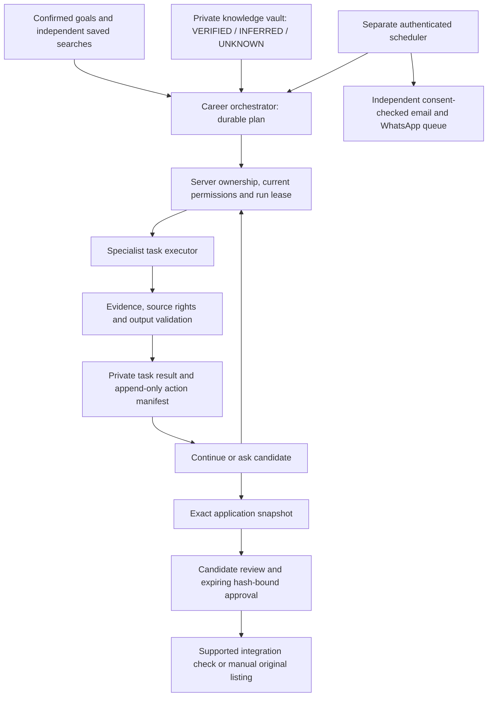

# Agentic career update — 12 October 2026

This extends the existing DnyanGanga Career Hub project, identity, private database,
URL and supplied logo. It adds a coordinated workflow engine and a candidate
Command Center. It does not create a replacement website or a new login system.
The reversible source tag is `pre-agentic-platform-2026-10-12`.

## Working architecture

The central Career Orchestrator creates an owned, durable plan. Each specialist
claims its task, checks current permissions, produces a validated result and
records its activity. A request has a bounded execution time and at most one
provider call; remaining work stays in the database for Continue or a configured
server scheduler. A browser closing does not delete the plan. Unattended execution
requires the separate scheduler deployment described below.

The 17 specialists are Profile, Resume Intelligence, Job Discovery, Job
Verification, Job Matching, Resume Tailoring, Cover Letter, Application
Preparation, Application Approval, Application Execution, Application Tracking,
Notification, Interview Preparation, Career Coach, Market Intelligence,
Follow-Up, and Security/Policy. These are logical executors sharing enforced
server policies, not seventeen unrestricted models. Local self-review is labelled
honestly; external AI remains a replaceable, explicitly configured adapter.

| Candidate control | Actual behavior |
| --- | --- |
| Assist | Discovery, verification, ranking and suggestions; automatic document/package preparation is blocked |
| Approval — default | Prepare private drafts/packages; candidate review is separate from execution |
| Agentic | Run permitted steps under current saved rules; cannot enable unsupported submissions or communications |
| Pause All Agents | Blocks new agent work and provider calls after the current policy check; queued alerts are cancelled |
| Individual pauses | Discovery, notifications, documents, applications and communications have separate gates |
| Knowledge states | Confirmed values are VERIFIED; proposals are INFERRED; absent factual answers remain UNKNOWN / ASK USER |
| Application approval | Exact snapshot hash, owner, revisions and one-hour expiry; material changes invalidate approval |
| Resume history | Originals and active resume remain separate from drafts; a review creates a new saved version |
| Submission | No application adapter is connected; original listing plus downloadable prepared package, never a false Applied status |

An in-flight provider request already accepted before pause cannot be recalled.
Unknown acceptance requires reconciliation and is not retried blindly. There is
no claim of exactly-once external delivery or autonomous application submission.

## Pages, source and database

The existing page map in README remains valid. The new route is
`/dashboard?view=agents`, with agent overview, saved searches, career facts and
answers, pending application reviews, history and automation settings.

| Main files | Purpose |
| --- | --- |
| `lib/career-agent-contract.ts` | Agent registry, operating modes, knowledge states, validation and canonical hashes |
| `lib/career-agent-store.ts` | Owned settings, searches, facts/history, answers, feedback, leases, tasks and exact packages |
| `lib/career-orchestrator.ts` | Bounded planning/execution, independent specialist outcomes and daily scheduler |
| `lib/career-agent-matching.ts` | Mandatory-filter-first ranking across nine disclosed factors and evidence coverage |
| `app/api/career/[...path]/route.ts` | Authenticated agent routes, owned export/download and final provider gates |
| `app/ui/agent-command-center.tsx`, `workspace.tsx`, `career-tools.tsx` | Command Center, navigation, pause notice and match explanations |
| `lib/career-ai.ts`, `career-alerts.ts`, `career-providers.ts` | Final permission hooks, minimized AI context and private external-action evidence |
| `db/schema.ts`, `drizzle/0004*`, `drizzle/0005*` | Additive agent tables and private snapshot history; no existing table replacement |

Apply only pending migrations, once, in order. Keep the schema, SQL and Drizzle
journal together. On a new local database apply 0000 through 0005. Existing
pre-agentic databases need 0004 and 0005. Follow the exact local commands in
README, substituting each pending file. Hosted migration execution belongs to
the native Sites release process. Retain additive tables during a source rollback;
do not drop candidate data.

Owner identifiers come from trusted identity, never browser payloads. Every
search, run, task, fact, answer, package and export is owner-scoped. Action
manifests and important history reject UPDATE at database level. Private
manifests can contain sensitive candidate material: they are not console logs,
analytics or public proof. Owned export includes agent records. Legitimate
account cleanup cascades to the new records, although the account-deletion API
remains disabled pending trusted recent authentication.

Deleting a standalone resume or conversation does not remove copies already
included in private application snapshots or immutable action history. These
copies remain owner-private and are included in the data export. Define and
implement an authorized retention/purge policy before collecting live sensitive
data; the build does not promise immediate deletion from history or backups.

Matching uses fixed weights totalling 100: role 15, skills 25, relevant experience
15, seniority 5, industry 5, location 10, compensation 10, work arrangement 5 and
career goals 10. Missing information earns no points and appears separately.
Coverage is the assessed portion of those weights. Salary comparisons use only
the same currency; monthly-to-annual uses twelve months, without assumed exchange
rates. These are transparent heuristics, not a hiring probability or an ATS
guarantee. Saved searches cannot expand a mandatory global location or work rule.

## Setup for unattended operation

No new secret names are required. `.env.example` contains names and placeholders,
not credentials. The existing `CAREER_SCHEDULER_SECRET` authenticates the internal
worker endpoint independently from any visitor session. AI, jobs and sending
feature flags stay disabled on this private build until their setup is complete.

1. Keep the existing private Site ID and D1/R2 bindings. Save an encrypted backup
   and verify restoration in a separate private environment before live migration.
2. Follow `docs/integrations-update.md` to deploy `worker/scheduler.ts` with the
   one-minute Cron, the exact approved HTTPS site origin, independent scheduler
   secret and authorized private Sites service access. Keep credentials in both
   hosts' secret stores and use separate development/production values.
3. Check the worker response and recent scheduler health in staging. A configured
   secret is not proof that Cron is deployed. The service credential grants no
   candidate identity; signed machine callbacks and the dedicated scheduler
   endpoint are its only intended routes.
4. In the candidate's Automation Settings enable daily runs and choose the IANA
   time zone. The plan is due around 07:30 local time; alerts default to 08:00
   Asia/Kolkata and retain their existing configurable time and separate consent.
5. Configure authorized employer boards, source display/digest/AI permissions,
   AI policy/model/budgets, verified email sender or official WhatsApp sender and
   approved templates. Verify destinations and consent through the candidate UI.
6. Test real staging sends, signed callbacks, pause/unsubscribe, source outage,
   deduplication and uncertain delivery before enabling a private pilot. Never
   treat a provider-accepted message as delivered without its delivery callback.

The scheduler and relay source are included, but the external worker, provider
credentials and approvals were not supplied or deployed in this update. Automatic
background execution and real digests therefore remain setup dependencies.
LinkedIn, Indeed, Naukri, LoopCV, Simplify and Resodro are not implied connections.
No scraping, CAPTCHA bypass, employer communication, payment or application
submission was activated.

## Control checklist and launch blockers

| Control | Status and evidence |
| --- | --- |
| Ownership, role separation and parameterized SQL | Implemented and tested locally; real SQLite two-owner tests and localhost API checks |
| Mandatory preferences ahead of ranking/learning | Implemented and tested; conflicting cities, unknown salary and saved-search boundaries |
| Verified facts separate from proposals | Implemented and tested; confirmation/history/revision checks and no model fact promotion |
| Exact approval, expiry and invalidation | Implemented and tested locally; package/context edits, pause/mode changes and stale snapshots |
| Durable leases and duplicate prevention | Implemented and tested locally; concurrent claims, run keys, expired work and per-channel digest fences |
| Immediate final pause/consent checks | Implemented and tested with injected providers; production in-flight timing not established |
| Append-only owned external-action records | Implemented and tested at SQLite level; production retention and operator access review required |
| Prompt injection / output boundaries | Implemented and tested against fixtures; AI has no privileged tools; model advice still needs human review |
| Secure upload scanner/isolation | Implementation preserved, externally required; uploads stay disabled until private processor is deployed and verified |
| Managed identity, MFA and fresh authentication | Existing identity preserved; administrator and sensitive unavailable actions stay disabled where attestations are missing |
| Real jobs, messages and unattended Cron | Externally required; provider approval, verified destinations and hosting access remain blockers |
| Automatic applications and employer messages | Disabled: no officially supported adapter and no action-specific communication authorization |
| Payment safety | Not applicable to this change; existing disabled billing/pricing preserved, no new plans or entitlements |
| Backup restoration, hosted two-account checks and load | Externally required / not tested; local tests do not prove hosted recovery or production capacity |
| Complete ASVS Level 2 review and privacy obligations | Partial implemented controls; independent review required, no certification or legal compliance claim |

The current engine is bounded for a private pilot: at most 20 saved searches,
200 retained runs, 60 tasks per run, 100 packages, 150 knowledge fields/answers
and 300 feedback entries. State/history needs pagination, archival and a measured
indexed due-job queue before broader scale. Existing alert throughput bounds
also prevent a 10,000-user synchronized dispatch promise. Limits are safeguards,
not measured service capacity. A new autonomous workflow can generate more AI
requests than the old manual cost assumptions; enforce the existing daily user
and global token budgets, measure actual usage, and revise the cost model before
setting commercial prices.

## Verification and maintenance

See `docs/agentic-test-results.md` for actual commands, results and untested work;
the dated prior results remain in `docs/test-results.md`. Use synthetic local data
only. Re-run the security, store, orchestrator, matching and provider tests after
policy changes, then the browser journey and production build.

During a pilot, monitor scheduler errors/stale health, paused queues, source
failures, uncertain sends, invalid signatures, run leases, AI budget refusals and
unexpected spending daily. Keep private contents out of operational logs. Review
dependency/security advisories weekly and source rights/consent/retention monthly.
Rehearse encrypted backup restoration and application/database recovery before
launch and after material infrastructure changes.

For an incident: pause all agents, disable the relevant provider flags, preserve
protected evidence, revoke exposed service credentials, reconcile uncertain
external actions with providers, restore only verified backups in private staging,
repair and retest the affected boundary, then resume explicitly. Configure a
real monitored security contact and operational alert destinations before launch;
no contact address is invented by this source.

Technical references: [Cloudflare D1 transactions and batches](https://developers.cloudflare.com/d1/worker-api/d1-database/),
[Cloudflare Cron](https://developers.cloudflare.com/workers/configuration/cron-triggers/),
[OWASP ASVS](https://owasp.org/projects/asvs/),
[OWASP prompt injection guidance](https://genai.owasp.org/llmrisk/llm01-prompt-injection/).

Recommendation: retain the private review audience, complete one authorized
employer feed and verified email staging setup first, then measure a small
approval-mode pilot before adding WhatsApp or any consequential integration.
