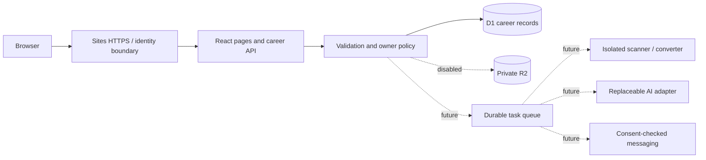

# Architecture and security handover

**Product:** DnyanGanga Knowledge Hub  
**Prepared:** 11 October 2026  
**Posture:** private test release; use fictional data.  
**Target:** applicable OWASP ASVS 5.0.0 Level 2, including relevant Level 1 requirements. Coverage is partial; no certification or compliance claim.

## Delivered scope and remaining stages

The public website and account workspace share a light interface. Demo data is explicitly fictional. The signed-in workspace uses server identity and relational persistence for profiles, preferences, manually edited resumes, manual jobs, applications, tasks, and notification settings.

A saved alert preference is not a running scheduler or proof of delivery. Resume editing is not secure PDF/DOCX ingestion. Question practice is not external AI feedback. Administrator operations remain unavailable. Features lacking a required security/provider capability are disabled server-side.

| Stage | Reviewable current work | Required to complete stage |
| --- | --- | --- |
| 1 | Public pages, ChatGPT sign-in, owned profiles/preferences, manual resume versions | Independent identity verification/recovery/MFA capability; quarantine/scanner/converter; original private files, previews/downloads, extraction review, sharing expiry/revocation |
| 2 | Manual job import, filter-first relevance, application tracking, alert preferences | Approved live source, expiry/deduplication, durable queue, timezone scheduler, verified destinations and real channel delivery/callbacks |
| 3 | Text-practice interface, coach/insights status views, career tasks | Guarded AI adapters, grounded cover letters, real sessions/history, voice permission/retention, current sourced market data |
| 4 | Settings integration-status view, pricing pending | Administrator MFA/roles/auditing, commercial adapters, measured load/restore tests, independent security review |

Manual jobs are not live Naukri/Indeed inventory. Do not present examples as verified vacancies, deliveries, users, endorsements, or security certification.

## Complete page map

| Route | Content / access |
| --- | --- |
| `/` | Home, product explanation, real interface preview, primary journey |
| `/features` | Profile, Resume Studio, matching/tracking/preparation overview |
| `/how-it-works` | Register → profile → resume → review → goals → matches → application → progress |
| `/faq` | Product, privacy, source, integration questions |
| `/contact` | Support/contact information; sending requires a configured real channel |
| `/pricing` | Plans awaiting configuration; no invented prices or checkout |
| `/privacy` | Data handling/provider boundaries; operator/legal review pending |
| `/terms` | Test-service terms; operator/legal review pending |
| `/security` | Security posture and current limitations |
| `/demo` | Fictional interactive session-memory dashboard |
| `/dashboard` | Signed-in owner workspace |
| `/dashboard?view=profile` | Profile, skills, goals, mandatory/flexible preferences |
| `/dashboard?view=resumes` | Manual editor/preview, versions, active selection; upload unavailable |
| `/dashboard?view=jobs` | User-supplied descriptions, relevance, source labels, uncertainty |
| `/dashboard?view=applications` | Saved / Preparing / Applied / Interview / Offer / Rejected / Withdrawn |
| `/dashboard?view=interview` | Text practice; AI/voice connection pending |
| `/dashboard?view=coach` | Career actions/context interface; provider pending |
| `/dashboard?view=insights` | Evidence/status view; no invented market research |
| `/dashboard?view=notifications` | Channel preferences, consent state, timezone |
| `/dashboard?view=settings` | Privacy, export/deletion, sharing/security status |
| `/signin-with-chatgpt`, `/signout-with-chatgpt`, `/callback` | Reserved Sites-owned identity routes |
| `/api/career/[...path]` | Owned server JSON operations; authorization independent of view |

Public content is prepared for an anonymous-facing website, while the initial deployment remains private. Changing the hosted audience is a separate release decision. No predictable public profile/resume addresses are published.

## Architecture and reusable design

| Component | Choice / purpose | Boundary |
| --- | --- | --- |
| Frontend | React 19.2.8, TypeScript, supplied Vinext starter, shared styles | Client state cannot authorize data or entitlement |
| Server | Cloudflare Workers with Sites integration | Trust hosted dispatch identity only; no origin bypass |
| Relational database | D1/SQLite with Drizzle migrations | D1 is not application row-level security; owner checks live in server code |
| Documents | Private R2 `BUCKET` reserved | Upload/processing disabled; no public bucket files |
| Identity | Sites Sign in with ChatGPT | Provides identity, not independently verified MFA/authentication recentness |
| Processing/queue/scheduler | Planned isolated scanner/converter and durable tasks | Not supplied by browser timers |
| AI | Planned replaceable server adapter with structured output/budgets | Model cannot authorize access, money, recipients, submissions |
| Sources/messaging/billing | Planned approved provider adapters | Disabled until implemented, approved, configured, tested |

Dependency remediation upgraded the starter to **Vinext 1.1.0**, Next 16.4.0, React/React DOM/RSC 19.2.8, Vite 8.3.4 and Wrangler 4.149.0. Keep the lockfile and stage upgrades. An unresolved build-tool advisory still needs reachability/release review; a version update does not establish security. The current choice follows supported Sites hosting and keeps pages/server operations in one project. Official references: [Vinext](https://github.com/cloudflare/vinext), [Workers](https://developers.cloudflare.com/workers/), [D1](https://developers.cloudflare.com/d1/), [R2](https://developers.cloudflare.com/r2/).

Design tokens: `#F8FAFC` background, `#FFFFFF` panels, `#2563EB` primary, `#0F766E` accent, `#0F172A` headings, `#475569` body, `#E2E8F0` borders. Shared rounded cards, restrained shadows, focus indicators, descriptive labels, responsive spacing, keyboard operation and reduced-motion rules apply throughout. Measure contrast and keyboard/mobile journeys; do not assume every pale badge passes.

Sites establishes the user. The API derives `userId` server-side; it never accepts client ownership or role claims. Every record lookup, update, delete and export must include that owner. IDs are not permissions. Email is contact/display data, not a durable owner key.

| Record | Storage / rule |
| --- | --- |
| Profile/preferences/draft | `career_accounts`; owner-only validated fields, profile/draft revisions, server autosave with stale-revision rejection; sign-in email provider-managed |
| Resumes | `career_resume_versions`; unique owner/version, traceable parent/profile revision, owned active ID |
| Manual jobs | `career_jobs`; source data/fingerprint; unique owner/fingerprint |
| Applications | `career_applications`; owned job/resume associations, user-confirmed stage/date |
| Plan tasks | `career_tasks`; real user completions drive progress |
| Notification settings | Owner account; channel-specific consent timestamps/audit; destination unverified until provider workflow exists |
| Audit/rate metadata | `career_audit_events`, `career_rate_limits`; server-owned metadata, exclude private text/keys |
| Future originals/previews | Private R2 opaque names, separate originals, quarantine before conversion/download |
| Future conversations/exports | Owner-scoped private records with minimum provider data and retention |

Foreign keys and unique indexes supplement service checks. A cross-owner foreign key must still be rejected. Schema-only migrations are versioned under `drizzle/`; initial migration is `0000_odd_reptil.sql` (seven tables). Never create migration-owned tables inside a request.

Matching is explainable rule-based relevance, not a universal ATS score or selection guarantee. Mandatory filters run first. Preferred cities override current-city fallback, and mandatory location/work arrangement must not expand. Missing evidence remains uncertainty. The current score is 60 × matched confirmed requirements / listed requirements + 20 for a matching target title + 20 for relevant experience within range. Example: one of two requirements matched with matching title and experience gives 30 + 20 + 20 = 70 out of 100. No requirements gives zero skill points. When an active resume exists, a profile-confirmed skill must also appear as a whole term in its text. Industry, salary expectation and relocation are stored preferences but are not semantic ranking inputs in this release; responsibilities/seniority/salary interpretation need the next-stage matcher. Exact rules are in `lib/career-core.ts`; preserve resume/profile revision context.

## Threat model and FMEA

Assets: contacts/career history, resume text, future conversations/files, destinations/consent, provider secrets, future orders/entitlements. Actors: ordinary users, another user, anonymous attacker, malicious document/job author, compromised provider, operator/admin. Current role is user; administrator actions are disabled.

| Failure mode | Cause / effect | Current boundary | Action / evidence needed |
| --- | --- | --- | --- |
| Other-user access | ID trusted without owner constraint; private disclosure | Server identity and scoped store | Two-user read/write/delete/export tests on every endpoint |
| Forged identity | Direct origin accepts attacker headers | Sites dispatch-only deployment required | Confirm identity-header stripping/replacement and no bypass origin |
| Forged mutation | Cross-site action reuses victim session | Origin, JSON and custom action-header checks | Test missing/hostile Origin and form/simple requests |
| Mass assignment | Role/owner/nested IDs override policy | Reject unexpected privileged fields | Inject keys and cross-owner associations |
| Malicious file | Macro/executable or ZIP bomb compromises parser | Upload disabled | Scanner, structure/expansion limits, isolated worker negative tests |
| Prompt injection | Imported instructions request keys/data/actions | External AI/tools disabled | No unrestricted model tools; adversarial tests and output schemas |
| Duplicate/wrong digest | Replay, timezone boundary, stale consent | Sending disabled | Durable unique claim, final consent, independent channels |
| Unpaid access | Redirect/fake webhook treated as money | Billing disabled | Signed events, server reconciliation, trusted minor-unit totals |
| Refund reversed | Late success overwrites newer refund | Billing disabled | Durable state machine and out-of-order reconciliation tests |
| Private cache | Shared response/storage exposes another user | Dynamic pages and API no-store | Inspect deployed headers and frontend storage |
| Revision race | Concurrent counters/active pointer inconsistent | Owner/version uniqueness, database workflow | Concurrent saves, owned restore, active-delete and failure cases |
| Account takeover | Unknown MFA/recovery/session strength | Managed identity; admin disabled | Obtain platform evidence and verified MFA/re-auth |
| Dependency exploit | Runtime, build-tool or parser vulnerability | Lockfile, reduced enabled surface | Audit/update/staging regression/independent review |
| Unrecoverable loss | Backup never restored | Restore procedure proposed | Isolated restore, ownership/version checks, deletion ledger |

Root causes are broken trusted authorization, unsafe processing boundaries, or treating UI/provider assertions as trusted state. Hidden buttons and badges cannot repair those causes.

## Security control checklist

Use four statuses: **implemented and tested**, **implemented but untested**, **externally required**, **not applicable with reason**. Partial controls stay unverified for launch. Pure unit tests cover only exercised logic; platform/provider/deployed behavior requires separate evidence.

IDs were verified in the [official pinned ASVS 5.0.0 release](https://github.com/OWASP/ASVS/tree/v5.0.0/5.0/en). This is a prioritized subset; complete the full applicability register before claiming Level 2 verification. Shortened IDs in a cell retain the `v5.0.0-` prefix.

| ID / control | Status | Implementation / evidence boundary |
| --- | --- | --- |
| `v5.0.0-1.2.1`, `1.2.2` output/URL encoding | Implemented but untested | React escaped text and safe links; hostile text/scheme tests |
| `v5.0.0-1.2.4` parameterized queries | Implemented and tested for store cases | Actual prepared SQL and SQL-like text tested in SQLite adapter; D1 runtime verification pending |
| `v5.0.0-1.3.1` rich HTML | Not applicable with reason | Plain text only |
| `v5.0.0-1.3.6` SSRF | Not applicable with reason for current import | No arbitrary server URL fetch; future feeds require allowlist/network/redirect protections |
| `v5.0.0-2.1.1`–`2.1.3` validation/limits documentation | Implemented but untested | Core schemas and handover; complete operation limits |
| `v5.0.0-2.2.1`–`2.2.3` server validation/consistency | Implemented and tested for covered cases | Core validation and local D1 HTTP body/role cases tested; complete input/hosted coverage pending |
| `v5.0.0-2.3.3` business transactions | Implemented and tested, partial | Resume insert rollback/active preservation tested in SQLite adapter; all business-flow/D1 concurrency verification pending |
| `v5.0.0-3.2.2` safe text | Implemented but untested | No untrusted HTML rendering |
| `v5.0.0-3.3.1`–`3.3.4` sensitive cookies | Externally required | Sites owns cookies; verify actual attributes/prefixes |
| `v5.0.0-3.4.1` HSTS | Implemented but untested, partial | HTTPS Worker sets one-year max-age; includeSubDomains not configured. Level 2 subdomain policy still requires ownership/hosting verification. |
| `v5.0.0-3.4.2` CORS | Implemented but untested | Inspect deployed trusted-origin policy; no sensitive wildcard |
| `v5.0.0-3.4.3`–`3.4.6` CSP/nosniff/referrer/framing | Implemented but untested, partial | Worker sets CSP/nosniff/referrer/frame policy. CSP still allows inline scripts and base-uri self; strict nonce/hash and base-uri none remain required before claiming L2 coverage. Verify actual deployed headers/embedding. |
| `v5.0.0-3.5.1`–`3.5.3` request forgery/methods | Implemented and tested at guard level, partial | Helper and local actual-D1 HTTP Origin/custom-header rejection tested; hosted behavior pending |
| `v5.0.0-5.1.1`, `5.2.1`–`5.2.3`, `5.4.3` safe uploads/scanning | Externally required | File ingestion disabled pending scanner/worker |
| `v5.0.0-5.3.2`, `5.4.1`–`5.4.2` paths/download names | Externally required for document files | Opaque names, owned download, safe attachment headers required |
| `v5.0.0-6.1.1`, `6.3.1` authentication abuse | Externally required | Identity service config; app mutation cap is not login defense |
| `v5.0.0-6.3.3` MFA; `6.8.4` auth strength/recentness | Externally required, launch blocker | Helper ID/email does not prove MFA/re-auth; administrator disabled |
| `v5.0.0-6.4.3`–`6.4.4` recovery | Externally required | Managed identity recovery evidence |
| `v5.0.0-7.1.1`–`7.1.3`, `7.3.1`–`7.3.2` session limits | Externally required | Obtain/test inactivity, absolute, concurrent and federation behavior |
| `v5.0.0-7.4.1`–`7.4.2`, `7.4.4` logout/termination | Implemented but untested, partial | Visible sign-out; revocation/replay/account-disable evidence required |
| `v5.0.0-7.5.1` sensitive auth changes | Externally required | Recovery/auth-factor changes not supplied; need fresh-auth capability |
| `v5.0.0-8.1.1`–`8.1.2` permission documentation | Implemented but untested | Owner and field rules in this handover |
| `v5.0.0-8.2.1`–`8.2.3`, `8.3.1` trusted authorization | Implemented and tested at store/policy level, partial | SQLite two-owner reads/updates/deletes/exports and association/privileged-key rejection; HTTP/dispatch two-user tests pending |
| `v5.0.0-12.1.1`–`12.1.2`, `12.2.1`–`12.2.2` TLS | Externally required | Hosted TLS/certificate policy; loopback is development |
| `v5.0.0-13.1.1` communication inventory | Implemented but untested | Current Sites/D1; future providers disabled |
| `v5.0.0-13.2.2`, `13.3.1`–`13.3.2` least privilege/secrets | Externally required | Bindings/secret store; repository/public-bundle scan |
| `v5.0.0-14.1.1`–`14.1.2` classification | Implemented but untested | Asset inventory and proposed retention; operator approval |
| `v5.0.0-14.2.2`, `14.3.2` private caching | Implemented but untested | Local HTTP no-store verified; deployed private-page/cache/header checks pending |
| `v5.0.0-14.3.3` browser storage | Implemented but untested | Private text must not enter localStorage/IndexedDB; inspect UI |
| `v5.0.0-14.2.4` protection per classification | Externally required, partial | At-rest encryption, provider terms, retention/deletion/backups |
| `v5.0.0-16.1.1`, `16.2.1`–`16.2.5` logging | Implemented but untested, partial | Action/entity/UTC metadata; central sink/access/retention needed |
| `v5.0.0-16.3.1`–`16.3.4`, `16.4.1`–`16.4.3` events/log protection | Externally required, partial | Platform auth logs; protected separate sink/alerts not verified |
| `v5.0.0-16.5.1` safe errors | Implemented but untested | Local failure responses exercised; comprehensive secret/stack/log exposure review pending |

Source chapters: [V1](https://github.com/OWASP/ASVS/blob/v5.0.0/5.0/en/0x10-V1-Encoding-and-Sanitization.md), [V2](https://github.com/OWASP/ASVS/blob/v5.0.0/5.0/en/0x11-V2-Validation-and-Business-Logic.md), [V3](https://github.com/OWASP/ASVS/blob/v5.0.0/5.0/en/0x12-V3-Web-Frontend-Security.md), [V5](https://github.com/OWASP/ASVS/blob/v5.0.0/5.0/en/0x14-V5-File-Handling.md), [V6](https://github.com/OWASP/ASVS/blob/v5.0.0/5.0/en/0x15-V6-Authentication.md), [V7](https://github.com/OWASP/ASVS/blob/v5.0.0/5.0/en/0x16-V7-Session-Management.md), [V8](https://github.com/OWASP/ASVS/blob/v5.0.0/5.0/en/0x17-V8-Authorization.md), [V12](https://github.com/OWASP/ASVS/blob/v5.0.0/5.0/en/0x21-V12-Secure-Communication.md), [V13](https://github.com/OWASP/ASVS/blob/v5.0.0/5.0/en/0x22-V13-Configuration.md), [V14](https://github.com/OWASP/ASVS/blob/v5.0.0/5.0/en/0x23-V14-Data-Protection.md), [V16](https://github.com/OWASP/ASVS/blob/v5.0.0/5.0/en/0x25-V16-Security-Logging-and-Error-Handling.md).

No password storage, LDAP/XPath/JNDI, GraphQL, WebSockets, native code or raw-card processing exists currently. Record those exclusions in the full register. Delegation does not exclude federated identity obligations. Level 2 MFA and asserted auth-strength/recentness are material unverified requirements.

## Payment protection

No checkout, charges, refunds, credits or paid entitlement is active. Unconfigured plans cannot unlock access. Never collect card numbers, CVV, banking passwords or passcodes in this app.

Before choosing a gateway, confirm merchant eligibility and supported hosted checkout in launch countries. Use its maintained official library. [Stripe hosted fulfillment](https://docs.stripe.com/checkout/fulfillment.md?payment-ui=stripe-hosted) and [webhook guidance](https://docs.stripe.com/webhooks) are design references, not an installed integration.

Required flow: trusted server catalog → integer minor-unit totals/taxes → owned pending order → gateway-hosted checkout → durable signed event → server API reconciliation → final paid/captured status → atomic entitlement. Match amount, currency, order, customer, merchant and live/test environment. Redirects, screenshots, IDs, pending or authorized status cannot prove paid access. Verify official signatures on original bytes and freshness where supported; signed webhooks must not require a browser session.

Persist unique events/idempotency keys; retry processing safely; handle concurrent/out-of-order events and prevent late success reversing refund. Sensitive refunds/subscription changes require server authorization, fresh verification and audit. Separate test/live entitlement. Confirm PCI DSS duties with the provider/acquirer. No automatic compliance claim.

## External setup and launch blockers

| Setup | Required action before activation | Status |
| --- | --- | --- |
| Identity | Verify dispatch trust/no origin bypass; obtain session/MFA/recovery/re-auth evidence | Required |
| Admin | Server-managed roles/allowlist, verified MFA/recentness, audited restricted document access | Disabled |
| Domain/TLS | Domain ownership, supported setup, HTTPS/TLS/HSTS/renewal review | Required for branded launch |
| Storage | Private R2; public development URLs off; no public custom bucket domain; separate test/production; least privilege | Upload disabled |
| Documents | Private scanner; PDF/DOCX structure validation, macro/executable rejection; 10 MB input plus unpacked/entry/time/memory limits; isolated conversion/OCR | Disabled |
| Sources | Approval/licensed discovery, display, AI/alerts usage, limits/retention and actual status | Unconnected |
| AI | Secret/DPA/retention decisions, model allowlist, per-user/global budgets, concurrency/timeouts, structured outputs, adversarial tests | Disabled |
| Email | Verified sending domain SPF/DKIM/DMARC, verified recipients, opt-in/suppression, signed status callbacks | Disabled |
| WhatsApp | Business account/number, approved template/category, explicit consent, verified callbacks/pricing | Disabled |
| Scheduling | Durable server queue/scheduler at 08:00 selected IANA zone, default Asia/Kolkata; refresh-before-send, unique dispatch | Disabled |
| Billing | Merchant approval, hosted checkout, trusted catalog, verified events/reconciliation/idempotency/refund tests, PCI review | Disabled |
| Security contact | Operator configures a monitored address and escalation owner; no address invented | Required |
| Privacy/legal | Operator identity, launch locations, providers, real retention/deletion terms and review | Required |
| Recovery/monitoring | Protected logs/alert sink, encrypted backups, isolated restore drill | Required |

See [integration research and costs](integrations-costs.md). No unapproved portal scraping is supplied.

Future digests should use a unique `(user, channel, local-date, schedule-revision)` dispatch key and sent-job suppression. Claim work durably; refresh listings; recheck consent/destination immediately before each channel send; store accepted and delivered separately. Unsubscribe cancels undispatched work. Channel failures are independent. Ambiguous provider timeouts require reconciliation when provider idempotency is unavailable; exactly-once external delivery cannot simply be promised.

## Actual evidence and acceptance

Only executed results appear here. Backend test output verified 28 passing policy/store cases and 25 local HTTP checks. A build and selected local browser checks passed; the final publication rebuild/deployment and remaining platform/provider checks stay pending until observed.

| Check | Repeat command / environment | Actual result |
| --- | --- | --- |
| Policy/store security tests | `node --experimental-strip-types --test tests/career-security.test.mjs` | **Passed 28/28**, zero failures, 473.0273 ms. Actual store SQL tested with in-memory SQLite D1 adapter and migration `drizzle/0000_odd_reptil.sql`; hosted HTTP/dispatch not covered. |
| Type check | `npm run typecheck` | Passed (exit 0), verified by owner agent |
| Build | `npm run build` / supported Sites helper | Upgraded-dependency build passed; latest bounded-body gate refinement requires final publication rebuild |
| Full dependency baseline | `npm audit --json` | Exit 1: **30 findings — 1 critical, 21 high, 7 moderate, 1 low**. Saved in `docs/dependency-audit.json`. Superseded by the post-remediation results below; original audit preserved as evidence. |
| Post-remediation full audit | `npm audit --json` | Exit 1: **8 high, zero critical/moderate/low**, all package findings trace to unresolved braces build/lint advisory. Saved in `docs/dependency-audit-after.json`; no patched stable version identified. |
| Production dependency audit | `npm audit --omit=dev --json` | Exit 0: **zero reported vulnerabilities**, saved `docs/dependency-audit-production.json`; excludes development dependencies and is not compiled-bundle reachability proof |
| Secret/client-bundle review | Approved scanner plus tracked/generated files review | Pending; no scanner success claimed |
| Native private deployment | Exact Site version and native terminal result | Pending |
| Browser/mobile QA | Local preview, desktop 1440 px and mobile 390 px | Seven selected demo checks passed, zero page errors and no horizontal overflow at those widths. Full authenticated, keyboard/accessibility and all-color contrast checks remain unverified. |
| Local actual-D1 HTTP smoke | `node tests/http-smoke.mjs` against loopback mock identity | **25 checks passed**, test records cleaned; Connection: close used because dev bridge keep-alive issue remains. Not hosted/two-account verification. |
| Deployed two-user isolation | Two real test identities plus anonymous calls | Not verified |
| Load/restore/provider sandboxes | Stated workload, isolated restore, each provider | Not run |

Acceptance checks must record identity, request, expected/actual response, version and environment, without leaking credentials/private text:

1. Anonymous career reads/writes/exports fail. A cannot read/update/delete/activate/export B's profile, resume, job, application, tasks or settings. Alter IDs/owner/role/nested associations and forge identity headers.
2. Hostile/missing Origin, action header, unsupported content type, oversized body, unknown privileged keys and excessive mutations fail safely. GET cannot become an unauthorized mutation path.
3. Concurrent resume saves have unique consistent versions; active references are owned; restore is traceable; active deletion stays consistent; failed processing preserves the prior active version. Match context records resume/profile revision.
4. Mandatory city/work arrangement never expands; preferences/current-city fallback/exclusions behave correctly; uncertain salary/experience is explicit; duplicate/closed jobs and manual/demo labels are handled.
5. Opening an external job does not mark Applied. Explicit user action records stage/date/resume. Progress uses persisted activity.
6. No private text in browser storage, URLs, public assets, logs or shared caches. Exports are owned; workspace deletion and identity switching are consistent.
7. When uploads/sharing exist, test corrupt/protected/mismatched PDF/DOCX, macros, executable content, archive expansion, unsafe paths, exhaustion, anonymous files, expired/revoked links and field/download rules. Until then endpoints fail closed.
8. When AI exists, injected document/job instructions cannot access other users, recipients, keys, money or applications. Test invalid/fabricated output, timeouts and budget limits. Until then operations are unavailable.
9. When alerts exist, repeated/concurrent scheduling is deduplicated, timezone/DST edges correct, unsubscribe cancels queued/future sends, source outage differs from zero matches, retries independent and accepted/delivered distinct.
10. When billing exists, altered amount/currency/order/customer/environment, fake redirect, invalid/stale signature, pending/test-mode, duplicate/concurrent and late-success-after-refund events cannot unlock improper entitlement or duplicate effects. Missing secrets fail closed.
11. Verify identity recovery expiry/single use, logout/disabled-account revocation, admin MFA/roles and fresh authentication. Keep unsupported sensitive features disabled.
12. Restore an isolated backup and apply deletion tombstones before access. Verify counts/ownership/revision/file links. Measure stated load, e.g. 100 concurrent fictional users with exact endpoints/duration and p50/p95/errors; repair/retest critical/high findings.

These are criteria, not fabricated passing results. Unit checks do not satisfy all release criteria.

## Retention proposal and maintenance

These timelines require operator/legal approval and implementation; they are not current automatic-deletion guarantees.

| Data | Proposed policy |
| --- | --- |
| Profile/resume versions | Active-account lifetime, user deletion, 12-month inactivity review |
| Failed/quarantined uploads | 24 hours unless documented short investigation hold |
| Exports | Delete after 24 hours; authorized download link maximum five minutes |
| Conversations/recordings | Recording opt-in, 30-day default, user deletion; no personality claims |
| Shares | Off by default, seven-day expiry, immediate revocation, contacts hidden/download permission separate |
| Account deletion | Disable app access immediately, active-record/file removal within seven days, cancel sends |
| Backups | Proposed maximum 30 days; deletion ledger applied before restored access |
| Security metadata | Proposed 90 days, restricted access, no keys/private text |

The underlying deletion routine covers app records and is tested, but its HTTP endpoint is disabled until the platform provides trusted recent-authentication attestation. It cannot delete the identity account or prove backup purge. Obtain actual hosting retention and match user-facing promises.

**Monitoring:** Configure a security contact and alerts for suspicious logins, denied access, parser/queue failures, invalid webhooks, mismatched money/environment, unusual AI/message/storage spend, missed scheduler runs and backup failures. Keep action/provider IDs/status/UTC timestamps; exclude bodies/prompts/addresses/keys/cookies/payment credentials. Verify alert delivery before claiming it works.

**Updates:** Triage critical advisories promptly; review dependencies/secrets weekly, test routine updates monthly, review roles/consents/unused secrets quarterly. Rotate compromised keys immediately. Individual operators require MFA on hosting, domain, source and provider accounts.

**Restore:** Export D1 with supported hosting/provider tools into restricted encrypted backup storage; separately protect future R2 originals/version manifests. Record schema/time/counts/integrity. Restore into an isolated test Site/database/bucket; apply migrations and deletion tombstones; verify ownership/revisions/files and representative journeys; measure recovery time/data loss. Never replay money or messages during restore. [D1 Time Travel documentation](https://developers.cloudflare.com/d1/reference/time-travel/) is a capability reference, not evidence a restore was performed.

**Incident:** Assign incident lead, restrict site/affected endpoints, pause sends/billing/jobs, preserve protected metadata, revoke exposed secrets/sessions using supported tools, identify boundary/affected records, fix root cause, restore only if necessary without resurrecting deleted data, retest, reconcile external money/messages, assess legal notification obligations, reopen gradually and record factual lessons.

Keep the exact tested deployed version, provider settings, backup drill, security-contact test, incident owner and outstanding risks. Broad launch remains blocked until authorization, auth strength, file safety, external verification, restoration and material dependency findings have real evidence.

## Implemented API surface and limits

Every enabled endpoint is under `/api/career` and derives its owner from the Sites server identity. State/export/text downloads use private no-store headers. Mutation requests require matching Origin, `X-Career-Action: 1`, and JSON content; no client-supplied owner or administrator role is accepted.

| Method / path | Operation |
| --- | --- |
| GET `/state` | Owned account state, matches and real activity counts |
| GET `/export` | Owned JSON export, attachment |
| GET `/resumes/:id/download` | Owned unchanged saved text version, safe internal filename |
| PUT `/profile` | Validated profile/preferences; optimistic revision check |
| PUT / DELETE `/draft` | Server-side resume autosave / discard; draft revision conflict protection |
| POST `/resumes` | New manual revision; uploaded/AI provenance cannot be forged |
| POST `/resumes/:id/active` | Explicit owned active-resume selection |
| POST `/resumes/:id/restore` | Restore as a new traceable version |
| DELETE `/resumes/:id` | Owned deletion and reference cleanup |
| POST `/jobs` | Validated manual job; duplicate owner fingerprint rejected |
| POST / PATCH `/applications[/:id]` | Owned tracker creation/update; Applied confirmation required |
| PUT `/notifications` | Consent/schedule preferences; channel enable remains blocked |
| POST / PATCH `/tasks[/:id]` | Owned career task creation/completion |
| DELETE `/account` | 503 unavailable until trusted recent-authentication attestation exists; underlying owned deletion routine tested in isolation |
| `/upload`, `/ai`, `/payment`, `/send`, `/share`, `/admin`, `/account` | Server-side 503 unavailable gates |

Configured code limits: 100,000-byte streamed JSON body, 60 mutations/user/minute, 60,000-character resume text, 100 resume versions, 500 imported jobs and 500 career tasks/user. Profile narrative fields allow up to 10,000 characters each, job descriptions 30,000 and application notes 5,000. These are development limits, not measured capacity. Mutation limiting does not protect identity-provider login or all expensive reads. Capacity is rechecked inside atomic insertion statements; the stale-preflight quota test passes. True simultaneous hosted D1 requests still need deployed concurrency/load checks; the adapter cannot establish hosted scheduling/network behavior.

No enabled core feature needs AI/message/payment keys. D1 is required and its absence returns an unavailable error. `.env.example` contains placeholders only; all advanced features remain disabled even if someone replaces a placeholder. Runtime-secret configuration is not a substitute for implementing the adapter, policy and tests.

### Local transport limitation

A Vinext development bridge/Miniflare keep-alive issue was observed after a framework-level foreign-Origin rejection: the following reused-connection request could fail. The 25-check smoke test uses Connection: close to isolate this local transport behavior. Consuming bounded bodies before application feature-gate responses repaired the analogous application-path unread-stream problem. This does not establish that the framework-level issue is absent from a built or hosted deployment; verify rejection followed by a normal request on reused connections during release tests.

