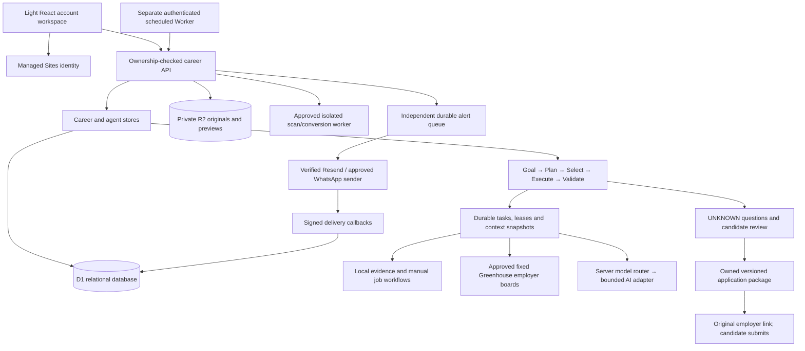

# DnyanGanga Career Hub: platform workflows and permissions

Updated 12 October 2026. This guide supersedes the earlier registry, Assist-mode, routing and fixed preparation-time descriptions in `agentic-workflows.md`. The current registry contains **21 logical specialist executors and one coordinator: 22 responsibilities**. They are bounded server functions with durable task records, not 22 independent external AI providers. A task name never proves that its external integration is connected.

## Architecture and data flow



React and the existing Vinext application provide the responsive interface. Cloudflare Workers runs the server routes; D1 stores relational ownership, revisions, campaigns, runs and private activity. R2 keeps documents private. The database is the authority for permissions, confirmed facts, package approval, alert consent and usage reservations. Model output has no direct database, payment, notification-recipient or submission tools. This keeps consequential decisions outside the language model.

Keep the existing managed identity integration rather than building a second password system. Managed identity recovery/session/MFA capabilities require provider evidence. Administrator actions, public sharing, sensitive account deletion and payments remain disabled where trusted authentication or supported integration is unavailable. The isolated processor requires a private service binding; a configuration flag cannot create that hosting capability. See [backend handover](backend-update.md), [agent data and history](agentic-data.md), [integration setup](integrations-update.md) and [architecture/security](architecture-security.md).

## Working user journey

```mermaid
flowchart LR
  A[Sign in] --> B[Confirm profile and goals]
  B --> C[Create text resume or approved upload]
  C --> D[Review extracted facts and unknowns]
  D --> E[Create independent campaigns]
  E --> F[Import a real description or refresh approved boards]
  F --> G[Mandatory filters then explained fit]
  G --> H[Prepare separate drafts and package]
  H --> I[Review facts, answers and package]
  I --> J[Open original employer page and submit yourself]
  J --> K[Confirm tracker progress]
  K --> L[Practice, learning plan and unsent follow-ups]
```



The local journey works with an owned manually imported job description and a text resume. Local self-review is labelled as such. Genuine discovery, document conversion/OCR, live AI, unattended scheduling and outgoing messages need their independent setup. A source outage means unavailable evidence, not that zero jobs exist. No fabricated live listings, sent applications, delivery events or customer outcomes are used.

## Page map

Public pages are Home, Features, How It Works, Pricing, FAQ, Contact, Privacy, Terms and Security. Sign-in uses managed identity. `/demo` is explicitly a demonstration workspace; `/dashboard` is the private account workspace. `/admin` remains gated and cannot grant itself administrator privileges.

Dashboard navigation includes Dashboard, My Profile, Resume Studio, Job Matches, Applications, Interview Practice, Career Coach, Market Insights, Notifications and Settings. The Command Center adds goals, saved campaigns, Knowledge Vault, Answer Library, package approvals, actual task activity and pause controls. The extended private tools cover learning tasks, saved recruiter contacts/interactions and manual interview records. These are workspace views, not public personal-profile URLs. No calendar, recruiter network, employer email or automatic submission connection is implied by a view.

## Coordinator and durable execution

1. Read the owned confirmed profile, preference revision, selected resume, campaign, vault and fresh answers. Persist missing questions as UNKNOWN without guessing a value.
2. Create one run per selected campaign, with an owner/local-date/context key. Repeated requests with the same context reuse that run; a browser nonce cannot replace the server key.
3. Create the 21 specialist tasks. Discovery creates a task for each approved board, so there may be more than 21 task records. Atomically claim the run and task with a lease before executing.
4. Execute at most one external discovery or AI call per invocation within an 18-second work budget. Remaining tasks stay queued for Continue or a later scheduler invocation. Database and network latency still need hosted measurement.
5. Immediately before each external request, reload policy/context, reserve AI quota where relevant and commit an immutable private request manifest. Recheck after recording the manifest and before the request. No provider credential is recorded in that manifest.
6. Validate provider output, ownership and current context before persisting. User changes stop stale work. An expired in-flight provider attempt becomes uncertain rather than being blindly replayed. Independent queued work may continue.
7. Save actual task outcomes: queued, running, completed, blocked, needs_input, awaiting_approval, unsupported, failed, uncertain or cancelled. Progress and counts come from saved records. A completed coordination pass is not proof that every external capability succeeded.

Assist researches, drafts and prepares private application packages while the candidate performs consequential actions. Approval is the default and adds explicit review before any future supported consequential action. Agentic can prepare bounded work under the same permissions; it cannot bypass exact permissions or user review. Submission and employer communication remain unsupported in every mode. All prepared drafts remain separate unreviewed versions. Neither selecting Agentic nor approving a package authorizes an unavailable action.

## Specialist permission matrix

Every read below is restricted to the authenticated owner or the scheduler's specific owned run. Every specialist obeys global/category pauses. Proposed facts, generated documents, answers and packages remain distinct.

| Specialist | Permitted result | Consequential boundary |
| --- | --- | --- |
| Profile | Missing-field review and UNKNOWN questions | Cannot promote proposed facts to VERIFIED |
| Resume intelligence | Selected resume structure/word observations | Cannot silently change or activate the original |
| Resume fact checker | Written-date, duration, repetition and unsupported-claim review flags | No authenticity determination or automatic correction |
| Job discovery | Approved fixed board GET and attributed owned upsert | No arbitrary URL fetch, scraping or submission |
| Job verification | Duplicate destinations, missing evidence and sensitive-request indicators | No fraud verdict or invented availability |
| Job matching | Mandatory-filter intersection and fixed evidence score | Cannot expand a mandatory preference |
| Resume tailoring | Separate unreviewed owned AI/local draft | Cannot replace the active original or add unconfirmed claims |
| Cover letter | Separate factual owned draft | Candidate review required before use |
| Application preparation | Up to three eligible private packages | Unknown questions remain ASK_USER |
| Application approval | Report required review and current snapshot | Only explicit user action grants expiring approval |
| Application execution | Original URL and package references | Unsupported; cannot submit or mark Applied |
| Application tracking | Read actual confirmed statuses | External page opening never counts as submitted |
| Notification | Channel readiness/settings | Independent alert queue owns verified sending |
| Interview preparation | Factual text practice and answer-based feedback | No camera, personality or honesty inference |
| Career coach | Confirmed-context suggestions and practical actions | Suggestions do not verify facts or guarantee outcomes |
| Learning | Distinct eligible explicit-requirement gaps and saved task progress | Completing a task never automatically verifies a skill |
| Market intelligence | Dated attributed owned sample and known pay fields | No invented market-wide trends or salary estimates |
| Networking | Unsent introductions from actual saved CRM contacts | No contact discovery, enrichment or employer sending |
| Follow-up | Unsent drafts from actual tracker, CRM due dates and completed interviews | No recipient invention or automatic messages |
| Cost control | Owned usage/reservations and configured token caps | No invented monetary invoice, entitlement or refund |
| Security policy | Ownership/revision/pause evidence | No administrator promotion or certification claim |
| Central coordinator | Plan/select/claim/validate/continue independent tasks | Cannot authorize actions prohibited for a specialist |

## Facts, resume variants and fresh answers

VERIFIED means explicitly confirmed by the candidate, not independently authenticated by a university/employer. AI_EXTRACTED, INFERRED and UNKNOWN remain unverified proposals. Local fact review compares exact VERIFIED statements; absence of a supporting statement does not establish that a claim is false. Written year ranges lack month precision; overlapping roles are not summed into invented total experience.

Each campaign can choose its own owned unarchived resume. Otherwise it uses the global active resume. A tailored draft or variant is a new artifact with source context; the original active pointer remains unchanged. Archiving/deleting/changing the selected document invalidates stale runs and approvals. Approval binds to the package's exact hash/revision/expiry and does not approve a later edit.

Answer freshness is server-controlled: joining/availability defaults to seven days, volatile salary/notice/work authorization/relocation/travel/shift answers to 30 days, and other screening facts to 90 days. Expired answers become UNKNOWN for use and require reconfirmation; they cannot be silently extended or invented. Actual employer questions must be supplied/reviewed. Automatic preparation starts with no screening-answer selections; the candidate explicitly selects fresh owned answer keys for the actual questions rather than copying an unrestricted answer library. An unrelated unselected expired answer does not become a package answer.

## Matching and Opportunity Priority

The fit score uses fixed weights totalling 100: role 15, skills 25, relevant experience 15, seniority 5, industry 5, location 10, compensation 10, work arrangement 5 and career goals 10. Unknown/unrequested factors earn no points; assessed coverage is reported. Exact qualifications appear in review evidence/gaps without creating a tenth factor or assuming degree equivalence. Salary compares declared same-currency monthly/annual ranges using 12 months; no exchange rate is invented. A default zero experience field is not a confirmed fresher claim.

Mandatory global policy runs first. Campaign filters are intersected with it, including any mandatory experience range. Empty campaign role/city/country/industry/arrangement/employment choices inherit global choices. For example, a mandatory global Pune choice excludes Mumbai even when a campaign asks for Mumbai. Excluded jobs cannot be rescued by a score, feedback or priority label.

Opportunity Priority is a separate High/Medium/Low queue indicator: assessed fit contributes 1–3; provided posting freshness contributes 0–2; configured city and comparable salary overlap add 1 each. Explicit preferred employer, known deadline and interest can contribute only when supplied to the priority function; these inputs are not inferred from text. Current ranking supplies evidence-based fit/city/pay/posting inputs. High is 6+ points, Medium 3–5 and Low below 3. Unknown dates/salary/deadlines contribute zero. Source check time is not a posting date. This is not a hiring probability or a change to fit.

Exact owned-job feedback reduces that job's separate queue score by 10, bounded at zero, with a visible reason. It leaves the nine-factor score and mandatory filters unchanged. Generic text feedback is retained for review, not reinterpreted as a fact or permission. Exact application destinations are grouped after stripping only known tracking parameters; job-ID queries are preserved and originals are retained.

## Configurable schedule and honest readiness

Preparation defaults to 07:30 Asia/Kolkata and disabled; choose any valid HH:mm and supported IANA time zone. Daily campaigns run on their active days. Weekly campaigns use their creation weekday in the chosen schedule time zone. Manual, paused and archived campaigns do not run unattended; having only these campaigns does not cause a fallback global run. With no saved campaigns, the explicit enabled schedule can use global goals. These weekday semantics should become an explicit weekday control if users need more flexibility.

The scheduler uses a 60-minute catch-up window. A late window crossing midnight keeps the preceding schedule date. A spring-forward nonexistent time starts at the first available minute and receives its catch-up window. Fall-back repetitions share a local-date idempotency key. Pause/Resume preserves the configured time. Normal next-run times require a recent observed worker request; configured secrets alone show awaiting_worker. Notification next times are not borrowed from preparation; they belong to channel readiness and the 08:00 alert schedule.

Use the existing separate `worker/scheduler.ts` and **`worker/wrangler.scheduler.example.jsonc`**, copied to a private local deployment configuration, with every-minute Cron. Install matching random `CAREER_SCHEDULER_SECRET` values in native Sites server secret storage and the external Worker. A private Sites audience also needs its legitimate narrowly scoped server service credential; this task does not mint it or deploy that Worker. Native Sites runtime values belong in its environment settings; a local `.env` or the external Worker's configuration does not configure the hosted site.

Pilot bounds are a global 120-second lease, at most 10 account rows per scheduler scan, one external call per invocation, 20 saved campaigns per account, 500 owned job records and 200 retained runs. All enabled/due campaigns receive durable runs, but completion may take further invocations. The cursor advances over processed owners. These limits are not measured capacity or a guarantee that all preparation finishes before 08:00. Ten thousand owners need at least 1,000 one-minute scans before considering task/network work, exceeding a one-hour due window. Scale with partitioned due queues, tenant quotas, measured concurrency, retention and provider licensing before expanding that audience.

## API map

All paths below start `/api/career`. Browser mutations require managed identity, an exact same origin and `X-Career-Action: 1`. Private responses use no-store. The server derives owner/context; payloads cannot set owner or trusted snapshot fields.

| Method/path | Purpose |
| --- | --- |
| GET `/state`, `/agents/state`, `/platform/state` | Private actual workspace, task/campaign state and manual platform records |
| PUT `/profile`, `/preferences`, `/agents/settings` | Validated profile/preferences/mode/pauses/schedule |
| POST/PATCH/DELETE `/agents/searches[/:id]` | Independent owned campaigns with selected resume/status/frequency |
| POST `/agents/vault/confirm`, `/agents/answers`, `/agents/feedback` | Explicit confirmation/fresh answers/job feedback |
| POST `/agents/runs` and `/agents/runs/:id/continue` | Start or continue bounded durable work |
| GET `/resumes/:id/analysis` | Owned structure, local fact flags and optional owned diff/job comparison |
| POST `/resumes/:id/variant`; PATCH `/resumes/:id/archive` | Separate versioned variant and archive control |
| GET `/resumes/:id/download?format=pdf\|docx\|txt` | Owner-authorized generated export |
| POST `/documents/upload`; GET `/documents/:id/preview` or `/original` | Quarantined upload, clean private preview/original |
| POST `/jobs`, `/jobs/refresh` | Manual description or approved fixed source refresh |
| POST/PATCH `/agents/packages[/:id]`; POST `/:id/approve` or `/:id/execute` | Server-built package, exact expiring review; execution remains unsupported |
| GET `/agents/packages/:id/download` | Owned package export |
| POST/PATCH/DELETE `/platform/goals[/:id]`, `/learning[/:id]`, `/recruiters[/:id]`, `/interviews[/:id]` | Owned manual goals/tasks/CRM/interview records; update/delete use expected revisions |
| POST `/platform/recruiters/:id/interactions`; GET `/platform/:group/:id/history` | Manual contact interactions and immutable owner-scoped history |
| POST `/ai`; POST `/ai-sessions/:id/review` | Server-built minimized AI context and explicit review of validated output |
| POST `/notifications/verify-request`, `/notifications/verify`; PUT `/notifications` | Destination verification and separate opt-in/pause settings |
| GET `/export` | Owned data export, with private audit contents |
| POST `/internal/scheduler` | Dedicated server authentication; no browser identity bypass |
| `/callbacks/resend`, `/callbacks/whatsapp`, `/notifications/unsubscribe` | Provider signature or signed opt-out authentication, independently of browser sessions |

Candidate URLs and records do not provide administrator authority. Payment and employer submission routes are deliberately unavailable. See the exact route and validation types for payload fields; do not send the illustrative path patterns literally.

## AI routing and external launch steps

`AI_TASK_ROUTES_JSON` is an operator-controlled map from `resume_tailoring`, `cover_letter`, `interview_preparation` and `career_coach` to `{provider:"openai",model:"an-approved-model"}`. A route must use the maintained adapter and a model in `AI_ALLOWED_MODELS`. Credentials, `AI_ENABLED`, data policy, output/token/request/global quotas and timeouts remain additional independent gates. Missing routes use explicitly labelled local self-review, without contacting a provider. The routing abstraction does not pretend unsupported providers have adapters.

Evaluate each approved model on factual preservation, schema validity, latency and cost using authorized test profiles before choosing task routes. The default server flags remain false until external staging checks pass. Confirm approved source display/digest/AI rights, verified destinations and opt-ins, Resend sending domain and signed callback, official WhatsApp sender/templates, server scheduler credential and isolated processor availability. Keep payments, administrator operations and employer sending disabled until their missing capabilities have independent implementation/review.

## Verification and remaining evidence

Repeat the owned focused checks from the repository with Node 22.13+:

```text
node --experimental-strip-types --test tests/agent-orchestrator.test.mjs tests/agent-matching.test.mjs
npx eslint lib/career-orchestrator.ts lib/career-agent-matching.ts lib/career-intelligence.ts tests/agent-orchestrator.test.mjs tests/agent-matching.test.mjs
npm run typecheck
```

Executed locally on 12 October 2026: **44 focused tests passed, zero failed, 4562.8261 ms** (32 coordinator/intelligence regressions and 12 matching regressions). The focused lint command and repository typecheck both exited 0. The screening regression prepopulates unrelated expired, generic fresh and same-job unselected answers; none is copied automatically, and the job-specific required slot remains UNKNOWN.

The focused tests use all checked-in SQL migrations in an in-memory SQLite D1 adapter and injected offline providers. They cover actual durable task counts, owner isolation, mandatory search intersection, selected campaign resumes, duplicate destinations, transparent feedback/fit/priority, model-route rejection, fact flags, learning counts, manual CRM drafts, owned usage, pauses, leases, uncertain provider attempts and schedule boundaries. They do not prove hosted transaction behavior, live source rights, actual provider delivery, domain/account setup, backup restoration or capacity. Full release results belong to the combined test handover; unfinished external checks remain launch blockers.

Use [research and operating-cost assumptions](platform-research-costs.md) and [failure analysis](platform-fmea.md) alongside the existing security control checklist. No legal compliance, ASVS certification, flawless AI or live delivery claim follows from this build.
