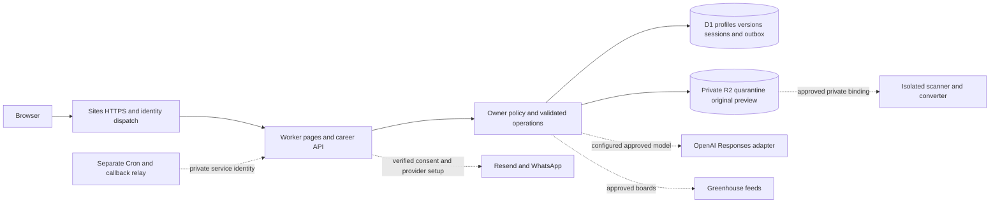

# DnyanGanga Career Hub — update handover

**Your AI-Powered Career Growth Platform**  
Prepared 12 October 2026. **Release posture: private review deployment; broad launch remains blocked.**

This document consolidates the current update. It supersedes older statements that AI, job-source adapters, document processing and the alert outbox have no implementation. Their source now exists, but live operation still depends on explicit configuration, provider permission and external verification. No live AI request, real message, merchant transaction, malware scan, production two-account isolation test or load test was performed during this update. Keep fictional data in the review environment.

The existing registered Sites project and private website are reused. The product name is DnyanGanga Career Hub; the source directory remains `sites/dolphin-career`. A local build, a saved site version and a successful private deployment are different evidence. Record the final deployed version and result before attributing tests to that version.

Detailed evidence and contracts: [AI update](ai-update.md), [connections and alerts](integrations-update.md), [backend update](backend-update.md), [processor reference](../services/document-processor/README.md), [original architecture/security register](architecture-security.md), [original test evidence](test-results.md), and [operating-cost assumptions](integrations-costs.md). Earlier test counts describe earlier source; the dated update reports take precedence for updated components.

## Current architecture and product status

| Component | Current implementation | Activation or remaining boundary |
| --- | --- | --- |
| Public website and workspace | Shared responsive React 19.2.8/TypeScript interface, Vinext 1.1.0, original branding, public information pages, fictional demo and signed-in workspace | Private Sites audience; operator contact, legal/privacy wording and launch decisions need review |
| Identity and server | Sites Sign in with ChatGPT, Cloudflare Worker, request-owned API/store | Only trusted hosted dispatch identity establishes an owner. Independent MFA, recovery, session/recent-auth attestations remain unverified |
| Relational data | D1/SQLite, Drizzle, 21 tables, four additive migrations | Apply migrations in order; no request-time tables. Real deployed D1 contention untested |
| Profiles and preferences | Owned revisions, server draft autosave/recovery, optional fields, mandatory/flexible filters, salary bounds and declared units | Missing mandatory job data fails the filter. No invented exchange rate or silent expansion |
| Resume Studio | Manual editing, version comparison, immutable saved revisions, restore as a new version, explicit active selection and traceable AI-reviewed saves | Plain-text export; polished PDF/DOCX generation, template/section controls and OCR incomplete |
| Uploaded documents | 10 MiB PDF/DOCX checks, private quarantine/original/preview paths, review/contact separation, deletion and processing CAS cleanup | Disabled without private R2, approved isolated scanner/converter binding and approval flag. Reference Linux service not deployed here |
| Matching and applications | Explainable filter-first matching, nullable fields, confirmed/related skill evidence, source attribution, tracking and explicit Applied confirmation | Relevance is neither a universal ATS score nor a hiring guarantee. No automatic application submission |
| Job connection | Fixed-origin official Greenhouse employer-board adapter; user-supplied descriptions remain available | Rights/configuration required; Naukri and Indeed discovery unconnected; no scraping fallback |
| AI and preparation | Replaceable server provider, OpenAI Responses adapter, strict output/evidence validation, owned context, budgets, private sessions, cover drafts and role-specific text practice | Live calls disabled without key, approved exact model, privacy acknowledgement and limits. Fallback labelled self-review. Voice/camera and sourced market research incomplete |
| Alerts | D1 outbox, local-day/channel dedupe, independent channels, destination verification, final consent/context checks, frozen email retries, signed callbacks and unsubscribe | External Cron/private relay, native secrets, sender/template approvals and real delivery tests required |
| Commercial/privileged functions | Server capability gates | Payments, public sharing, administrator operations and account deletion disabled; browser flags cannot unlock them |



D1 does not supply application row-level security. Each store is constructed for the server-derived user ID; parameterized queries, owner predicates and owned associations enforce isolation. Browser roles, IDs, hidden buttons and AI text confer no permission. Provider callbacks and scheduler requests have separate server verification and do not require a candidate browser session.

Private data includes contacts/career history, documents and extracted text, resume versions, applications, conversations/answers, generated drafts, destinations/consent and provider references. Secrets are server-only. Ordinary users have only their records; administrator access is unavailable. No orders, card data or paid entitlements are processed.

## Page map

Public routes: `/`, `/features`, `/how-it-works`, `/faq`, `/contact`, `/pricing`, `/privacy`, `/terms`, `/security`. `/demo` is fictional. `/dashboard` requires sign-in and uses `?view=profile|resumes|jobs|saved|applications|interview|coach|insights|notifications|settings`; its default is Dashboard. Saved Jobs uses `?view=saved`. There is no active administrator dashboard; admin status is unavailable and its API is gated. Sites owns `/signin-with-chatgpt`, `/signout-with-chatgpt` and `/callback`. Owned API operations live below `/api/career/`; current contracts are in the component guides.

Public pages, sidebar, header, forms, editor and settings share a light design, descriptive labels, focus styles, reduced-motion rules and responsive layouts. Local desktop/mobile journeys passed; this is not a full assistive-technology, contrast or accessibility audit.

## Verification observed so far

The final integrated local command passed **109 tests: 50 core/store + 32 AI + 27 provider/alert; zero failures**, total duration **1,520.0184 ms**. Root recorded this combined rerun after integration. The final saved/deployed source version is still a separate release record; local results do not establish production identity or live provider operation.

| Check | Actual evidence and practical limit |
| --- | --- |
| Core/store policy and transactions | 50 passed. Prepared SQL against SQLite using all migrations; mocked R2/processor. Covers isolation, revisions/rollback, mandatory filters, uploads/contacts, storage races, AI budget/provenance and old-schema upgrade. Not deployed D1 or two real sessions |
| AI policy | 32 passed. Synthetic keys/responses; exact evidence, candidate-only fact rendering, injected text, no tools, gates, limits, accounting and timeout. No live quality, billing or retention evidence |
| Provider/alert policy | 27 passed. SQLite and mocked feeds/senders; official Resend signature checks, replay/order/rollback, concurrent dedupe, fresh consent/context and identical retry bodies. No live send or Cron |
| Processor policy | Final Python run: 8 tests passed, 0.017 seconds. Real DOCX parsing plus mocked scanner ordering/failures. No real ClamAV, Linux isolation, Docker build or tunnel |
| Browser journeys | Final browser baseline 7, account 8 and upgrade 9 local groups passed, zero page errors, including persistence, responsive widths and explicit active-resume deletion. Loopback mock identity and fictional records; no production two-account result |
| Local HTTP | Final local D1 HTTP smoke: 36 checks passed. Development connection reuse failure observed; tests use `Connection: close`. Hosted transport and two real deployed accounts still require evidence |
| TypeScript / build / lint | Final integrated typecheck/build passed. Focused module lint: 0 errors, one ignored-worker warning. Full lint: exit 1, 98 errors and 12 warnings in baseline/source; it is not clean |
| Dependency audit | Production-only npm audit: 0 findings. Complete/build audit: 8 high package findings from one unresolved braces advisory, [GHSA-vfj7-8cjw-p6xm](https://github.com/advisories/GHSA-vfj7-8cjw-p6xm). Reachability/build review remains a blocker; the narrower audit does not prove a safe bundle |
| Secret scan | Final source/client heuristic scan: 53 text files, 0 key-pattern matches, 0 server-marker matches; saved in `secret-scan-update.json`. No real keys supplied. This is not a comprehensive source-history or credential proof |
| Built-Worker browser policy | 9 checks passed: per-response script nonce, hydration, injected inline script blocked, no-store HTML, anonymous API denial and security headers. Local loopback; HTTPS/HSTS and deployed identity unverified |
| Deployment / recovery / performance | Private update only; exact result recorded by deployment owner. No restore drill, production contention measurement, stated-load result or public-release claim |

Repeat from the project directory, with local preview active for browser/HTTP checks:

```powershell
node --experimental-strip-types --test tests/career-security.test.mjs tests/career-ai.test.mjs tests/provider-alerts.test.mjs
node node_modules/typescript/bin/tsc --noEmit --incremental false
node scripts/run-framework.mjs build
node tests/http-smoke.mjs
node tests/browser-smoke.mjs
node tests/account-browser-smoke.mjs
node tests/upgrade-browser-smoke.mjs
node tests/header-smoke.mjs
npm audit --omit=dev --json
npm audit --json
```

The combined command above is the final observed suite command and may be repeated after changes. Browser scripts require installed Playwright/browser configuration described in the README/test evidence. Header tests target the built loopback preview. From `services/document-processor`, repeat `python -B -m unittest test_processor.py`. Preserve actual output, version/commit, nonsecret configuration, test identities and cleanup evidence; record new results after source/configuration changes.

## ASVS Level 2 control checklist

The [official release list](https://github.com/OWASP/ASVS/releases) identifies **5.0.0 as the latest stable release**; bleeding-edge text is not the baseline. IDs below were checked against pinned official English source. This is a prioritized applicability/evidence register, **not an assessment of every Level 1/2 requirement**. Complete the full register and independent review before claiming Level 2 verification.

Statuses: **implemented and tested** only for stated local evidence; **implemented but untested** for code/configuration without sufficient verification; **externally required** for hosting/provider/operator work; **not applicable** only while the explained function is absent. Partial coverage remains a launch gap.

| Official requirement ID(s) and area | Status | Code/evidence and remaining verification |
| --- | --- | --- |
| `v5.0.0-1.2.1`, `v5.0.0-1.2.2`, `v5.0.0-3.2.2` text/URLs | Implemented and tested, limited | React text, escaped email HTML, safe schemes and hostile input cases. Review every final rendering/download context |
| `v5.0.0-1.2.4` database injection | Implemented and tested | Parameterized owner-bound SQL; SQL-like private text remains data |
| `v5.0.0-1.3.6`, `v5.0.0-13.2.4`, `v5.0.0-13.2.5` outbound destinations | Implemented and tested, partial | Fixed AI/job/provider origins, redirects rejected, approved board paths; no user-job-URL fetch. Egress/firewall and processor tunnel unverified |
| `v5.0.0-1.5.1`, `v5.0.0-1.5.2` parsers | Implemented and tested, partial | Strict JSON/schema and DOCX XML/entity/structure rejection. Native PDF tools and Linux isolation externally required |
| `v5.0.0-2.1.1`–`v5.0.0-2.1.3` documented limits | Implemented but untested for full coverage | Schemas/guides describe sizes, revisions, consistency and quotas; complete endpoint register required |
| `v5.0.0-2.2.1`–`v5.0.0-2.2.3` server validation | Implemented and tested, limited | Strict keys, numeric ranges/currency basis, owned associations and bounded bodies/output. Deployed all-input coverage required |
| `v5.0.0-2.3.1`–`v5.0.0-2.3.4` sequence/atomicity | Implemented and tested, partial | Explicit Applied/review confirmation, revision CAS, unique outbox and transactional callbacks; SQLite rollback/concurrency regressions. Real D1 contention pending |
| `v5.0.0-2.4.1` abuse limits | Implemented and tested, partial | Mutation caps, verification limits, AI user/global quota/single lease, bounded scheduling/feed/parser work. Edge controls, GET pagination and measured abuse/load required |
| `v5.0.0-3.3.1`–`v5.0.0-3.3.4` cookies | Externally required | Sites owns sessions. Verify Secure, HttpOnly, SameSite, host scoping and prefixes on exact deployed flow |
| `v5.0.0-3.4.1` HSTS | Implemented but untested, partial | Worker HTTPS policy; hosted TLS and all-subdomain policy require ownership/certificate review |
| `v5.0.0-3.4.2`–`v5.0.0-3.4.6` browser headers | Implemented and tested locally, partial | Fresh script nonce/CSP, nosniff, referrer/framing; 9 built-Worker checks including hydration and injected script rejection. Hosted identity/TLS, CSS policy and base-URI/subdomain coverage still require full Level 2 review |
| `v5.0.0-3.5.1`–`v5.0.0-3.5.3` request forgery/methods | Implemented and tested, local | Same-origin mutation, custom header, JSON/content/stream limits; callbacks independent of browser cookies. Hosted CORS/origin behavior pending |
| `v5.0.0-5.1.1`, `v5.0.0-5.2.1`–`v5.0.0-5.2.3` uploads | Implemented and tested, partial | `career-documents.ts`: 10 MiB PDF/DOCX, encryption/macros/ZIP path/count/expansion rejection. Actual parser corpus/load pending |
| `v5.0.0-5.3.2`, `v5.0.0-5.4.1`–`v5.0.0-5.4.2` storage/download | Implemented and tested, partial | Opaque private keys, owned unchanged originals, safe attachments and race/DB-failure cleanup. Hosted R2 anonymity/caches/integrity unverified |
| `v5.0.0-5.4.3` malware | Externally required | Approved scanner binding fails closed; mocks do not establish detection. Real private scan/signatures/quarantine/resource controls required |
| `v5.0.0-6.1.1`, `v5.0.0-6.3.1`, `v5.0.0-6.4.3`–`v5.0.0-6.4.4` identity/recovery | Externally required | Obtain managed recovery/login evidence. Destination verification is not account recovery or MFA |
| `v5.0.0-6.3.3`, `v5.0.0-6.8.4` strength/recentness | Externally required, blocker | No trusted MFA/recent-auth assertion in helper. Privileged capabilities gated; ordinary sign-in is not Level 2 MFA evidence |
| `v5.0.0-7.1.1`–`v5.0.0-7.1.3`, `v5.0.0-7.2.1`, `v5.0.0-7.2.4`, `v5.0.0-7.3.1`–`v5.0.0-7.3.2`, `v5.0.0-7.4.1`–`v5.0.0-7.4.2`, `v5.0.0-7.5.1` sessions | Externally required, partial | Identity helper/sign-out exist. Verify rotation, inactivity/absolute/concurrent lifetime, logout replay and fresh auth; visible logout does not prove invalidation |
| `v5.0.0-8.1.1`–`v5.0.0-8.1.2`, `v5.0.0-8.2.1`–`v5.0.0-8.2.3`, `v5.0.0-8.3.1` authorization | Implemented and tested, partial | Owner-bound private records/files/exports and rejected role/owner keys. Two deployed accounts, anonymous files and identity spoofing remain mandatory |
| `v5.0.0-12.1.1`–`v5.0.0-12.1.2`, `v5.0.0-12.2.1`–`v5.0.0-12.2.2` transport | Externally required | Hosted TLS/certificates and authenticated processor tunnel; loopback is development |
| `v5.0.0-13.1.1` service inventory | Implemented but untested for deployment | Guides inventory fixed destinations, gates, deadlines and retries |
| `v5.0.0-13.2.1`–`v5.0.0-13.2.3`, `v5.0.0-13.3.1`–`v5.0.0-13.3.2` service secrets | Externally required, partial | Private boundary/nondefault secrets required; shared-secret reference is not verified short-lived service identity. Native least privilege, rotation/access and final secret scan need evidence |
| `v5.0.0-14.1.1`–`v5.0.0-14.1.2`, `v5.0.0-14.2.4` classification/protection | Externally required, partial | Assets/retention proposal below; encrypted storage/backups, jurisdiction/provider terms and deletion must match actual promises |
| `v5.0.0-14.2.2`, `v5.0.0-14.3.2`–`v5.0.0-14.3.3` caching/browser storage | Implemented and tested, limited | Private no-store; server draft/history and no private document browser persistence by design. Final storage/shared-cache/back-navigation checks required |
| `v5.0.0-16.1.1`, `v5.0.0-16.2.1`–`v5.0.0-16.2.5` logging | Implemented but untested, partial | Action/entity/status/UTC metadata; sink, retention/access, redaction and monitoring delivery unverified |
| `v5.0.0-16.3.1`–`v5.0.0-16.3.4`, `v5.0.0-16.4.1`–`v5.0.0-16.4.3` event coverage/protection | Externally required, partial | Managed auth logs, denied/control-failure inventory and protected separate sink need completion |
| `v5.0.0-16.5.1` safe errors | Implemented and tested, limited | Gates/errors hide provider bodies, stacks and secrets; final framework/deployment/log review required |

Pinned sources: [V1](https://github.com/OWASP/ASVS/blob/v5.0.0/5.0/en/0x10-V1-Encoding-and-Sanitization.md), [V2](https://github.com/OWASP/ASVS/blob/v5.0.0/5.0/en/0x11-V2-Validation-and-Business-Logic.md), [V3](https://github.com/OWASP/ASVS/blob/v5.0.0/5.0/en/0x12-V3-Web-Frontend-Security.md), [V5](https://github.com/OWASP/ASVS/blob/v5.0.0/5.0/en/0x14-V5-File-Handling.md), [V6](https://github.com/OWASP/ASVS/blob/v5.0.0/5.0/en/0x15-V6-Authentication.md), [V7](https://github.com/OWASP/ASVS/blob/v5.0.0/5.0/en/0x16-V7-Session-Management.md), [V8](https://github.com/OWASP/ASVS/blob/v5.0.0/5.0/en/0x17-V8-Authorization.md), [V12](https://github.com/OWASP/ASVS/blob/v5.0.0/5.0/en/0x21-V12-Secure-Communication.md), [V13](https://github.com/OWASP/ASVS/blob/v5.0.0/5.0/en/0x22-V13-Configuration.md), [V14](https://github.com/OWASP/ASVS/blob/v5.0.0/5.0/en/0x23-V14-Data-Protection.md), [V16](https://github.com/OWASP/ASVS/blob/v5.0.0/5.0/en/0x25-V16-Security-Logging-and-Error-Handling.md). Labels summarize rather than replace full requirements/levels.

Exclusions: no app password store, LDAP/XPath/JNDI, LaTeX, GraphQL, WebSockets, user HTML/SVG/template editing, raw-card entry or live payment processing. These absent functions are not applicable; managed identity obligations still apply. Payment protection becomes mandatory before activation. Sharing/revocation is not tested because sharing is disabled. Voice/recording controls are not applicable while capture is disabled. Native parser/memory controls still apply to the external PDF/scanner service; TypeScript does not exclude them. Complete remaining applicable chapters, including APIs, tokens, cryptography and secure development/configuration, in the full register.

## Threat model and concise FMEA

Main misuse paths: forged identity/ownership, costly request abuse, malicious file/job text, replayed provider events, unwanted messages, revision races and compromised operator credentials. Probability/loss are unmeasured; no invented risk-priority number is assigned.

| Failure / effect | Root cause | Current control and evidence | Remaining preventive action |
| --- | --- | --- | --- |
| Other-user disclosure/change | Missing owner predicate or identity bypass | Owner-bound SQL/cross-owner regressions | Two-account deployed endpoint/file/export tests; verify spoof stripping/no bypass origin |
| Malicious upload execution/exhaustion | Unsafe parser/archive/public original | Limits/quarantine/scan+hash gate, mock negative/race tests | Real private scanner/runtime/image corpus and cleanup drill |
| Invented qualifications or hidden AI instructions | Model prose promoted to facts/actions | No tools; exact evidence; server fact-only reviewed document | Live adversarial/quality review; free-form advice still needs inspection |
| Duplicate/unwanted digest | Concurrent claim, stale consent/context, uncertain retry | Unique claim/final consent/lineage, frozen email and uncertainty fences | Live reconciliation/callback/opt-out; started external send cannot be recalled |
| Lost/regressed callback state | Acceptance before durable state, out-of-order event | Atomic event/state/marker; rollback/replay/terminal tests | Real D1/provider timing/retries |
| Orphan file/stale extracted profile | Delete/process race or missing CAS | Conditional processing/cleanup and revisioned review tests | Hosted R2 failure injection/object reconciliation |
| Unpaid access/duplicate refund | Trusting redirect/browser amount/replay | Payments/entitlements disabled | Hosted checkout/trusted minor-unit price/final paid state/event/refund tests |
| Account takeover/privileged change | Unknown MFA/recovery/recentness | Managed identity; privileged capabilities disabled | Verified MFA/step-up/session and individual operator access |
| Late 08:00 delivery | Bounded scan/outbox and synchronized load | Explicit pilot bounds/status | Indexed next-due queue and measured capacity before SLA |
| Deleted data/message replay after restore | Backups omit deletion/side-effect ledger | Procedure proposed; no drill | Tombstones/version/file reconciliation with sends disabled |

## External setup and exact activation gates

Keep `AI_ENABLED`, `CAREER_JOBS_ENABLED`, `CAREER_ALERTS_ENABLED` and `DOCUMENT_PROCESSOR_APPROVED` false until their acceptance work passes. Configure hosted values through native Sites environment tools using `project_id` in `.openai/hosting.json`; secrets require `is_secret:true`. Local `.env` values do not configure native Sites. Preserve existing keys and deploy the saved version tied to that environment revision. Never put keys in `NEXT_PUBLIC_*`, browser code, the hosting manifest, logs or examples.

1. **Hosting/identity:** retain private audience and `DB`/`BUCKET` bindings. Keep R2 public development URLs and public bucket/custom-domain access off. Require HTTPS and inspect headers/CORS/caches on the exact host. Use individual MFA-protected operator accounts for hosting/domain/repository/providers. Verify session lifetime, logout invalidation, recovery, signed identity and trusted MFA/recent-auth; retain gates where unavailable. Configure edge rate/bot controls and a monitored security contact. Its address must be supplied and tested, not invented.
2. **Schema:** apply `0000_odd_reptil.sql`, `0001_flippant_talisman.sql`, `0002_clean_whiplash.sql`, `0003_smiling_nightmare.sql` once in order. Hosted Sites applies registered migrations; verify its result. For local D1 use the README's generated Worker config/command for each pending migration. Back up first and test an old-schema upgrade in staging.
3. **Documents:** deploy the reference on a dedicated Linux host, pin reviewed image digests, supply a secret of at least 32 characters, real ClamAV signatures, private HTTPS tunnel and enforced CPU/memory/time/temporary-storage/no-egress limits. Set bridge `DOCUMENT_PROCESSOR_ORIGIN`, store `DOCUMENT_PROCESSOR_TOKEN` as a Worker secret, retain `workers_dev=false`/`preview_urls=false`/no public routes, and attach `CAREER_DOCUMENT_PROCESSOR` only through supported hosting configuration. Confirm the binding with the operator. Test clean files, EICAR, corrupt/encrypted files, ZIP/macros/external XML, wrong hash/secret, scanner failure and interrupted storage. See [processor commands](../services/document-processor/README.md). Unsupported binding means upload stays disabled.
4. **AI:** install `OPENAI_API_KEY` as a native server secret. Select `AI_PROVIDER=openai`, explicit `AI_MODEL` and matching `AI_ALLOWED_MODELS`; review data notice/terms before `AI_DATA_POLICY_APPROVED=true`. Set `AI_MAX_OUTPUT_TOKENS` (256–4096), user `AI_DAILY_REQUEST_LIMIT`/`AI_DAILY_TOKEN_LIMIT`, global `AI_GLOBAL_DAILY_TOKEN_LIMIT`, and optional `AI_TIMEOUT_MS` (1000–20000). Run a fictional-data test of the actual model/schema/refusal/usage/timeout before `AI_ENABLED=true`. `store:false` is not zero retention. Token quotas are not a dollar cap; configure provider spending controls/invoice alerts. See [AI setup](ai-update.md).
5. **Jobs:** configure at most ten authorized `GREENHOUSE_BOARDS_JSON` entries with `board`, verified `company`, `rightsConfigId`, `displayAllowed`, `digestAllowed`, `aiAllowed`. Unapproved rights stay false. Enable only after terms/retention and snapshot/closure/source tests. Naukri/Indeed need approved discovery/redistribution/AI access; no guessed endpoint is supplied.
6. **Email:** verify an owned domain using Resend DNS records and operator DMARC policy. Set secrets `RESEND_API_KEY`, `RESEND_WEBHOOK_SECRET`, nonsecret `RESEND_FROM`, `RESEND_SENDER_VERIFIED=true`. Callback: `https://YOUR_RELAY_HOST/webhooks/resend`; subscribe to delivery/failure/bounce/complaint/suppression. Test raw-body SDK signatures, invalid events, verification codes and unsubscribe. Accepted does not mean delivered/read.
7. **WhatsApp:** configure approved sender, supported `WHATSAPP_GRAPH_VERSION`, `WHATSAPP_PHONE_NUMBER_ID`, secrets `WHATSAPP_BUSINESS_TOKEN`, `WHATSAPP_APP_SECRET`, `WHATSAPP_VERIFY_TOKEN`. Set approved `WHATSAPP_DIGEST_TEMPLATE`, `WHATSAPP_VERIFICATION_TEMPLATE`, `WHATSAPP_TEMPLATE_LANGUAGE`, `WHATSAPP_TEMPLATES_APPROVED=true`. Digest needs one body variable; verification needs the documented code/button template. Callback: `https://YOUR_RELAY_HOST/webhooks/whatsapp`. Test signature, sender, code/delivery and signed STOP on authorized destinations. Check current Meta category/limits/rates first.
8. **Cron/relay and consent:** copy `worker/wrangler.scheduler.example.jsonc` to the ignored actual config. Set exact `CAREER_SITE_ORIGIN`; retain `SITES_PRIVATE_AUDIENCE=true`. Obtain supported private service access. Store `SITES_SERVICE_BEARER` and independent 32-character `CAREER_SCHEDULER_SECRET` as Worker secrets and the same scheduler secret in native Sites. Site also needs exact `CAREER_PUBLIC_ORIGIN`, `CAREER_ALERT_RELAY_ORIGIN`, 32-character `CAREER_VERIFICATION_SECRET`. Deploy separate one-minute Cron only after setup authorization; avoid duplicate schedules. Use [exact Wrangler instructions](integrations-update.md). `CAREER_ALERTS_ENABLED=true` still requires verified destinations, fresh per-channel consent and real staging send/callback/unsubscribe tests. Destination change resets consent; pause/opt-out stops unsent queued work.
9. **Payments:** remain disabled; gateway/prices unconfigured. Before enabling select eligible official hosted checkout and merchant approval. Server-owned orders/prices use integer minor units. Reconcile owner/order/merchant/amount/currency/environment and documented final paid/captured status before entitlement. Verify raw signatures/freshness, durable dedupe, concurrent fulfillment/refunds, delayed reconciliation and out-of-order refund protection. Browser success, pending/authorized payments and test events cannot unlock live access. Confirm PCI responsibilities with gateway/acquirer; no automatic compliance claim.

The scheduler is a **bounded pilot**: 50 scans and 30 dispatch attempts/minute, 60-minute catch-up, 120-second leases. At 10,000 accounts scanning alone needs at least 200 minutes; 20,000 dual-channel attempts need at least 667 minutes at the bound. These lower bounds exclude feed/database/provider work. Current design cannot support an 08:00 promise at that scale. Add indexed next-due pagination and scalable queues, then measure stated load. Full-content state responses also need pagination/detail retrieval and high-quota payload tests.

Cost allowances for 100/1,000/10,000 active users remain planning scenarios, not quotations or supported throughput. [The assumptions](integrations-costs.md) and [updated limitations](integrations-update.md) explain exclusions and unverified AI/WhatsApp allowances. Replace them with actual approved provider rates and measured pilot usage before setting plan prices.

## Remaining release blockers and acceptance work

- Repair or independently review the unresolved high dependency finding, full-lint baseline and final build/server bundle; rerun affected checks. No broad launch recommendation while material findings remain unresolved.
- Verify production dispatch/header spoofing, two users on every private operation/export/file, anonymous originals/previews, sessions/logout/recovery and MFA/recent-auth.
- Deploy/verify scanner/storage, approved feed/model, native secrets/private relay/Cron, real destination consent/STOP/unsubscribe and signed callbacks. Absent capabilities stay disabled.
- Exercise real D1 revision/quota/outbox/callback races; closed/failed-source jobs and changed mandatory preferences must not send. Reconcile uncertain sends before retry/config changes.
- Restore an isolated encrypted backup with deletion records before access and external replay prevention. No restore evidence exists.
- Measure concurrency/data volume, p50/p95 latency, errors, resource use and scheduler lag. Fix pagination/capacity before large audiences/commercial promises.
- Complete full ASVS register, independent review, launch-location privacy/provider retention review, accessibility and final bundle secret scan. No legal/security/PCI certification claimed.

## Proposed retention and operational maintenance

These are **proposals, not configured guarantees**. Operator/provider capability and privacy review must approve them before public wording promises a timeline.

| Data | Proposed rule |
| --- | --- |
| Profile, resumes and cover drafts | Keep while needed by owner; specific deletion available. Define inactivity review before launch |
| Quarantined/failed uploads and temporary data | Reconciled cleanup within 24 hours for abandoned quarantine; temporary conversion files removed per attempt. Verify before claiming |
| AI/interview history | Latest 12 turns currently retained per session; owner deletion available. Define time-based expiry separately; bounded history is not a retention timer |
| Notification history/provider references | Proposed 90 days; retain minimum uncertainty/deduplication evidence as needed to prevent duplicates; do not purge fences blindly |
| Protected security metadata | Proposed 90 days, restricted access, no private bodies/contact/credentials; confirm incident/legal needs |
| Encrypted backups | Proposed maximum 30 days; actual D1/R2/provider schedules require verification. Apply deletion ledger before restored access |

Account deletion remains disabled pending trusted fresh authentication; underlying owned cleanup is tested. It does not delete the identity-provider account or prove backup purge. Supply a real support-assisted privacy process and exact provider/backup timelines before sensitive-data launch.

**Daily during a pilot:** inspect scheduler lag/stale health, source/parser failures, webhook rejection/backlog, uncertainty, quota settlement, unusual AI/message/storage spend and delivery complaints. Failures in one channel must not block another. Configure a monitored security contact and alerts for suspicious sign-ins/denied access, exposure, webhook failures and future payment mismatches. Verify alert delivery with synthetic events; no active security-alert delivery is claimed.

**Weekly:** review dependency/advisory changes, lockfile and container images; stage upgrades and rerun policy/HTTP/browser checks. Apply urgent verified fixes promptly. **Monthly:** review source/provider rights, model allowlist/costs, consent/retention, operator access and key scopes; test opt-out and representative restoration. Rotate exposed keys immediately and routine service credentials under supported expiry/policy; coordinate sender-account changes with uncertain-send reconciliation. **Quarterly and before material releases:** independent boundary review, full restore/incident rehearsal and measured load.

Backup and restoration runbook:

1. Assign an owner and approve recovery point/time targets; neither is measured yet. Create encrypted restricted D1 exports or supported Time Travel points and private R2 object/version/hash manifests. Capture migration version/UTC times. Use native hosting/provider tools; ordinary Wrangler is not assumed to reach Sites-managed D1. [D1 Time Travel](https://developers.cloudflare.com/d1/reference/time-travel/) is a capability reference, not a completed drill.
2. Keep keys separate from backups. Record owned counts, active-version pointers, document hashes, consumed AI reservations, consent/revocations, outbox payload/provider IDs/uncertainty and callback dedupe. Preserve deletion ledger independently of snapshot.
3. Restore into a new isolated private Site/database/bucket with provider/AI/scheduler flags false and no live outbound keys. Apply migrations. Restore related files/records coherently; apply deletion/revocation ledger before access. Do not resurrect deleted files or old consent.
4. Verify two-owner isolation, hashes, version counters/active references, draft/session revisions, quotas and exports. Reconcile outbox/provider acceptance before any dispatch; never automatically replay messages, AI calls or future charges after restore.
5. Run representative journeys, measure recovery time/data loss and record results. Cut over only through reviewed hosted deployment and gradual monitored reopening. Retain protected rollback evidence and remove test restoration on its approved schedule.

Incident runbook:

1. Assign incident lead, record UTC scope/version, restrict affected service and disable AI/jobs/alerts/processing or future billing as needed. Preserve protected metadata and immutable source/build; do not copy private documents or secrets into tickets/logs.
2. Revoke/rotate exposed service credentials and supported sessions; restrict operators and inspect identity/provider/platform logs. Identify the failed boundary and affected owners/files/destinations/side effects. Treat leaked keys, unauthorized access and uncertain sends separately.
3. Fix root cause, reproduce with synthetic regression cases and retest adjacent ownership/revision/consent/event paths. Patch dependencies/configuration; restore only if integrity requires it, applying deletion/revocation records first.
4. Reconcile externally accepted messages, usage/invoices and future financial state before retry/reopening. Assess actual notification obligations with responsible privacy/legal adviser; this runbook claims no compliance.
5. Reopen a small private cohort, verify monitoring and document factual impact, prevention and assigned follow-up owners. Keep disabled capabilities gated until their evidence is complete.

Recommended next step: a small private fictional-data pilot, followed by one authorized board and one verified email channel after real acceptance tests. Add live AI, WhatsApp and uploads independently after each boundary passes. Keep billing, sharing, administration and destructive account actions unavailable until their authorization/security requirements can be enforced and tested.

